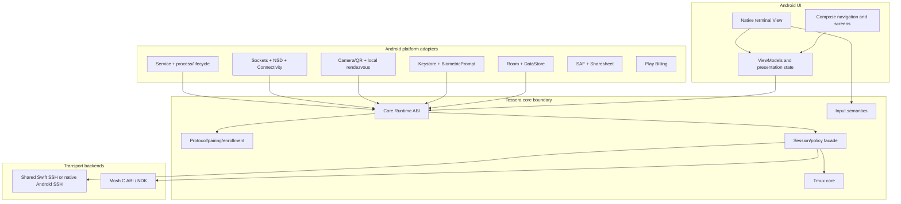
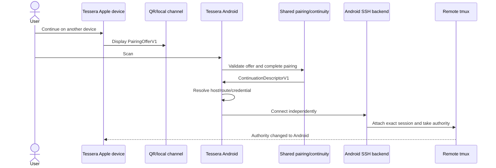

# Tessera Android Architecture

## Android implementation after Shared Platform Enablement

**Status:** Proposed downstream technical specification
**Date:** August 23, 2026
**Repository baseline:** [`bambouville/tessera`](https://github.com/bambouville/tessera) public `main` at commit [`68183c2`](https://github.com/bambouville/tessera/commit/68183c2c5d5de99c1f8adc94b44e4f579e2de7f0), plus the completed shared predecessor described in `tessera-shared-platform-refactor-protocol-architecture.md`
**Hard precondition:** the shared platform-enablement release gate has passed
**Audience:** Android, transport, terminal, security, QA, and release engineering

---

## 1. Executive decision

Build Android as a **native Kotlin/Compose application over the shared Tessera contracts and portable core**, not as a screen-by-screen SwiftUI translation and not as a separate reimplementation of continuity, bootstrap, enrollment, tmux policy, or host security.

After the shared predecessor, Android inherits:

- secret-free host and route models;
- capability-based credential and signer contracts;
- continuation descriptor v1;
- legacy nearby-bootstrap v2 compatibility specifications;
- purpose-bound pairing v1 for QR/local flows;
- bootstrap manifest v2 and transaction ordering;
- enrollment message/state-machine behavior;
- owner-authorization and policy-generation rules;
- known-host trust semantics;
- session commands, events, and typed challenges;
- tmux parser/topology/grid-authority behavior;
- input semantics;
- fixed protocol and tmux vectors.

Android supplies the parts that should be native:

- Compose UI and responsive phone/tablet navigation;
- Android terminal rendering and IME/input integration;
- Room/DataStore persistence;
- Android Keystore and `BiometricPrompt`;
- Android sockets, NSD, QR camera integration, connectivity, and lifecycle;
- foreground-service policy;
- Play Billing;
- Storage Access Framework and Sharesheet integration;
- platform notifications and permissions.

The target is:

```text
Android native shell
  Kotlin + Compose
  Room + DataStore
  Android Keystore + BiometricPrompt
  Android terminal View
  Android lifecycle/network/service adapters
          │
          ▼
Tessera stable command/event boundary
  shared protocol + pairing + enrollment
  shared host/trust/policy semantics
  shared tmux/input behavior
  shared SSH only if portability gate passes
          │
          ▼
Mosh C++ core through a stable C ABI
```

The Android branch must not reopen the shared architecture merely to make local UI implementation easier. Where a shared Swift implementation is not viable, Android replaces it behind the same normative contract and vectors.

---

## 2. What this document no longer owns

The earlier Android architecture document included work now moved into the common predecessor.

| Removed from Android branch | New owner |
|---|---|
| Extract continuation schema from app target | shared protocol work |
| Split `Host` public configuration from secrets | shared domain work |
| Generalize enrollment peer binding and key metadata | shared enrollment work |
| Separate TOFU policy from JSON/NIOSSH storage | shared trust work |
| Create session command/event facade | shared session work |
| Split tmux deterministic state from Observation | shared tmux work |
| Define QR pairing transcript and transaction contracts | shared pairing work |
| Migrate current Apple app to new abstractions | shared Apple-adapter work |
| Establish protocol vectors and compatibility matrix | shared CI/specification work |

The Android branch starts with those APIs frozen.

---

## 3. Goals

1. Deliver a high-quality Android phone and tablet terminal client with SSH, tmux, and Mosh behavior consistent with Tessera on Apple platforms.
2. Consume shared protocol and policy behavior without exposing Swift implementation details to Android UI code.
3. Use Android Keystore keys through non-exportable signing operations where possible.
4. Support Android-native IME, hardware keyboard, mouse, trackpad, selection, and lifecycle behavior.
5. Provide QR-based cross-OS continuation and setup using the shared pairing protocol.
6. Preserve direct device-to-server connections and avoid a mandatory Tessera backend.
7. Represent Android process death and background restrictions truthfully.
8. Keep every shared backend replaceable behind the stable facade.
9. Maintain behavior parity through cross-platform conformance tests rather than pixel parity.
10. Ship one responsive application for phones, tablets, foldables, and resizable windows.

---

## 4. Non-goals

1. Running SwiftUI, UIKit, SwiftData, StoreKit, Apple Security, or `NSUserActivity` on Android.
2. A cross-platform UI or terminal renderer.
3. Pixel-identical Apple and Android screens.
4. Rewriting the Mosh core in Kotlin or Swift.
5. Making Android v1 dependent on a Tessera cloud account or relay.
6. Migrating private keys from Apple devices automatically.
7. Claiming a local transport survived Android process death.
8. Maintaining an Android-specific fork of Tessera’s wire behavior.
9. Blocking the entire Android product indefinitely on Citadel/SwiftNIO SSH portability.
10. Shipping files, forwarding, billing, and every Apple feature before terminal fundamentals are reliable.

---

## 5. Inherited branch contract

Android may rely on the following stable interfaces from the shared predecessor.

### 5.1 Domain

```text
HostProfile
HostEndpoint
HostRoute
HostLaunchPolicy
LocalCredentialReference
ConnectionRequest
CredentialCapability
TrustedHostRecord
PortForwardRule
```

No shared host object contains a password or private-key bytes.

### 5.2 Protocol

```text
ContinuationDescriptorV1
PairingOfferV1
PairingHandshakeV1
PairingFrameV1
PairingStreamRecordV1
PairingQRTextCodecV1
CrossDevicePairingRuntimeV1
ContinuationTransactionV1
BootstrapManifestV2
BootstrapTransactionV1
LegacyNearbyBootstrapV2
LegacyNearbyHandshakeHelloV2 / LegacyNearbyHandshakeCommitmentV2
LegacyNearbyHandshakeV2 / LegacyNearbyManifestTransferSessionV2
EnrollmentMessageV1
DevicePublicKeyDescriptorV2
```

### 5.3 Session, input, and tmux

```text
SessionCommand
SessionEvent
SessionChallenge
SessionGeneration
TmuxSnapshot
GridAuthoritySnapshot
TmuxRuntimeEngine
TmuxFixedQuery
TmuxCompactClientSizing
TmuxCompactCanvas
TmuxStamplessPeer
AutoTmuxCommands
TerminalModifiers
TerminalKey
TerminalKeySequenceEncoder
TerminalMouseEvent
TerminalMouseSequenceEncoder
TerminalInputMode / TerminalInputReset
TerminalInputStateMachine
```

`Packages/TmuxControl` ships two targets: the portable `TmuxControlCore` and
`TmuxControl`, declared `platforms: [.iOS, .macOS]`, which holds
`TmuxController.swift` and `AutoTmuxScript.swift`. `TesseraCoreABI` may depend
only on the portable target, so anything left in the Apple-only one is
invisible to Android and gets reimplemented in Kotlin — which is exactly how
the two platforms drift. The Kotlin copy of the attach commands read
`ignore-size` as a general geometry-preservation capability and offered it to
the `-CC` control client at attach time; the Apple builder had always confined
it to the visible mosh client. An Android phone therefore attached as a
permanent observer, adopting the server grid instead of publishing its own —
the peer-sized canvas scaled to illegibility. Shared tmux *policy* therefore
belongs in `TmuxControlCore`, consumed by both platforms; the Apple-only target
keeps the controller and its Apple surface.

### 5.4 Platform adapter responsibilities Android must implement

The names below are architectural roles for the Android application, not Swift
symbols exported by the shared packages. Android defines these interfaces in
Kotlin around the public contracts in sections 5.1–5.3; it must not add a
second protocol or transaction state machine behind them.

```text
HostRepository
CredentialRepository
CredentialSigner
KnownHostsRepository
FreshOwnerAuthorizer
PairingByteConnection
PairingRendezvous
BootstrapManifestImporter/Exporter
SessionLifecycleHost
PortListener
PurchaseEntitlement
TerminalSurface
```

---

## 6. Android application architecture



---

## 7. Android module layout

```text
android/
  app/
    application, navigation, DI, top-level lifecycle, release config

  feature-hosts/
    host list/editor, routes, identities, known hosts

  feature-session/
    session presentation, challenge sheets, tmux tabs/panes, restore UX

  feature-pairing/
    QR scan/render, bootstrap, continuity, enrollment presentation

  terminal/
    terminal emulator/view wrapper or fork
    IME, keyboard, mouse, selection, accessibility

  data/
    Room database, migrations, repositories, DataStore preferences

  security/
    Android Keystore, signer capabilities, BiometricPrompt, app lock

  networking/
    local sockets, NSD, connectivity callbacks, port listeners

  lifecycle/
    active-session service, notifications, restore records

  billing/
    Play Billing and entitlement adapter

  files/
    Storage Access Framework, download/upload destinations, share intents

  core-bridge/
    native library loading, handles, DTO mapping, callback dispatch

  core-native-fallback/
    optional native SSH or protocol adapters behind the same contracts
```

Feature modules depend on contracts and repositories, not directly on JNI/Swift/C++ types.

---

## 8. Shared-core bridge

Every shared behavior reaches Kotlin the same way: portable Swift core →
`@_cdecl` exports in `TesseraCoreABI` declared in `TesseraCoreABI.h` → a JNI
shim → a Kotlin object. Android adds no policy on that path; it maps arguments
and results.

### 8.1 Coarse facade

Kotlin should see a handle-based API such as:

```text
CoreRuntime.create(config) -> RuntimeHandle
CoreRuntime.createSession(runtime, configDTO) -> SessionHandle
CoreRuntime.command(session, commandDTO)
CoreRuntime.sendInput(session, directByteBuffer)
CoreRuntime.resize(session, cols, rows)
CoreRuntime.respondToChallenge(session, responseDTO)
CoreRuntime.destroySession(session)
CoreRuntime.destroy(runtime)
```

Callbacks:

```text
onTerminalBytes(session, generation, directByteBuffer)
onSessionEvent(session, generation, eventDTO)
onTmuxSnapshot(session, generation, snapshotDTO)
onChallenge(session, generation, challengeDTO)
onDiagnostics(session, generation, redactedEventDTO)
```

### 8.2 Boundary rules

- terminal data crosses in batches, not per byte or cell;
- low-frequency DTOs may use generated wrappers or canonical JSON;
- direct buffers are preferred for terminal output and input;
- stateless policy helpers cross as plain value calls with no handle; their
  string results follow one contract — a null or zero-capacity output buffer
  returns the required byte count — so a command whose length depends on the
  session name is sized exactly instead of truncated by a fixed ceiling;
- native handle destruction is explicit;
- no reliance on Java garbage-collection timing;
- every callback includes a generation;
- stale callbacks for a destroyed/replaced session are ignored;
- callbacks from one runtime are serialized in accepted-operation order, never
  overlap, and may move between ABI-owned executor threads;
- Android never assumes main-thread affinity and marshals presentation state to
  the main dispatcher;
- Keystore and terminal work do not block the main thread.

### 8.3 Packaging gate

The official Swift SDK for Android can cross-compile Swift packages with the Android NDK, but the whole Tessera graph still requires proof. The branch begins with a measured packaging gate:

1. compile each selected shared package for arm64 Android;
2. load the native library in a minimal physical-device app;
3. run protocol and tmux vectors;
4. stream realistic terminal batches;
5. exercise cancellation and destruction;
6. measure binary size, startup, memory, and callback overhead;
7. verify release/R8/packaging behavior.

The UI architecture must remain unchanged if one shared implementation is replaced.

---

## 9. SSH backend decision gate

The repository’s `Packages/Citadel/Package.swift` currently declares only iOS and macOS and depends on a Tessera-selected SwiftNIO SSH fork, SwiftNIO, Swift Crypto, BigInt, and Swift Log. The preferred outcome is shared SSH behavior, but it is not guaranteed.

### 9.1 Required backend contract

Both candidates must provide:

```text
connect direct route
connect ordered jump route
host-key observation and challenge
password authentication
public-key signer callback
PTY open
stdin/stdout/stderr
resize
exec channel
direct-tcpip channel
cancellation
policy-generation revalidation
redacted diagnostics
```

### 9.2 Shared Swift SSH passes only if

1. Citadel and the complete dependency graph compile on the selected Swift Android SDK.
2. DNS, IPv4, IPv6, cancellation, and errors work on physical devices.
3. Direct SSH and at least one jump host work.
4. Host-key verification feeds the shared trust policy correctly.
5. Android Keystore can satisfy signing without exporting the private key.
6. PTY, exec, direct-tcpip, and Mosh bootstrap work.
7. callback and buffer overhead are acceptable.
8. release builds load reliably on supported ABIs.
9. binary size and cold-start cost are acceptable.
10. maintenance does not require a fragile permanent fork of multiple upstream libraries.

### 9.3 Native Android fallback

If the signer or dependency gate fails, implement `AndroidNativeSSHBackend` with a mature JVM/Kotlin SSH library or a narrowly wrapped native backend.

The fallback must consume the same:

- `HostProfile` and route;
- policy generation;
- signer capability;
- known-host policy;
- session commands/events;
- conformance scenarios.

Do not translate tmux, pairing, or enrollment merely because SSH is native.

### 9.4 Decision record

The gate produces an ADR containing:

- tested toolchain and dependency commits;
- physical devices/ABIs;
- signer implementation;
- measured performance;
- unsupported features;
- maintenance burden;
- chosen backend and fallback trigger.

---

## 10. Persistence

### 10.1 Room entities

Suggested entity separation:

```text
HostEntity
IdentityEntity
HostJumpLinkEntity
PortForwardRuleEntity
KnownHostEntity
RemoteAccessLedgerEntity
SessionRestoreEntity
PairingAuditEntity
```

Secrets do not live in Room plaintext.

### 10.2 Repository mapping

Room repositories map to shared domain snapshots. They also provide transactional operations for:

- bootstrap import planning;
- conflict detection;
- restricted import;
- durable import acceptance;
- identity/key linkage;
- known-host import conflicts;
- access-ledger intent and verification;
- interrupted transaction recovery.

### 10.3 DataStore

Use DataStore for device-local preferences:

- app lock policy;
- terminal appearance;
- notification preferences;
- foreground-session behavior;
- onboarding state;
- local file destinations;
- entitlement cache metadata.

Portable settings import through the shared settings mapper. Android-only settings never enter a bootstrap manifest.

### 10.4 Recovery markers

Persist reconstructible state only:

- host/session ID;
- transport kind;
- tmux target;
- last UI selection;
- whether a local transport must reconnect;
- interrupted bootstrap/enrollment marker.

Do not persist:

- live password;
- private key;
- Mosh session key;
- QR optical secret;
- raw pairing transcript secrets;
- terminal contents unless a separately designed local scrollback policy is approved.

---

## 11. Android key security

### 11.1 Keystore policy

The Android Keystore can keep key material non-exportable and restrict its use. Implement a capability-oriented `AndroidCredentialStore`.

For each key, record locally:

```text
algorithm
exportable
ownerAuthenticationRequired
authenticationValidity
securityLevel
StrongBox requested/available
attestation available/verified
invalidation rules
creation time
canonical public SSH blob
```

### 11.2 Algorithm strategy

Preferred order should be capability-based rather than brand-based:

1. P-256 key usable by the selected SSH backend and hardware-backed where available;
2. software Ed25519 when the user explicitly accepts exportable/recoverable software protection or hardware P-256 is unavailable/incompatible;
3. no dishonest “hardware-backed” label when runtime evidence is absent.

StrongBox should be an optional policy, not a universal requirement; availability and performance vary.

### 11.3 Signer boundary

```kotlin
interface CredentialSigner {
    val keyId: UUID
    val algorithm: SshPublicKeyAlgorithm
    val publicKeyBlob: ByteArray
    val capabilities: SignerCapabilities

    suspend fun sign(
        attemptId: UUID,
        policyGeneration: Long,
        payload: ByteArray,
        signatureAlgorithm: SshSignatureAlgorithm
    ): ByteArray
}
```

Before and after `BiometricPrompt`:

- verify attempt ID;
- verify policy generation;
- verify app-lock state;
- verify key still exists and is valid;
- consume authorization according to policy;
- reject stale completion.

### 11.4 Key invalidation

Treat `KeyPermanentlyInvalidatedException` and other invalidation states as explicit product flows:

- mark identity unusable;
- block silent fallback;
- offer generate/rotate/re-enroll;
- preserve access-ledger information for revocation;
- never claim the old server key was removed until verified.

### 11.5 App lock

App lock revokes:

- cached owner authorization;
- pending signer requests;
- pending host-key decisions;
- active pairing approvals;
- pre-connect attempts.

An already connected transport policy is a product decision, but new signing or setup mutation must not proceed behind the lock screen.

---

## 12. Known hosts

`AndroidKnownHostsRepository` stores canonical shared trust records and implements atomic operations for:

- unknown;
- trusted;
- changed;
- reverted;
- explicit replacement;
- continuation-hint match;
- owner-authorized import;
- conflict preservation;
- OpenSSH import/export.

The SSH backend supplies canonical SSH wire blobs. The shared trust core computes/validates fingerprints and policy decisions.

Requirements:

- continuation hints annotate the local prompt only;
- imported trust never overwrites a different local pin silently;
- changed keys remain visible after a dismissed prompt;
- every trust mutation is explicit and auditable locally;
- endpoint normalization matches shared vectors.

---

## 13. Terminal surface

### 13.1 Chosen direction

Use a pinned, reviewed Android terminal emulator/view implementation, with the Termux `terminal-emulator` and `terminal-view` modules as the leading baseline. Vendor a Tessera-owned fork or pin an exact reviewed artifact; do not depend on an unpinned moving branch.

The terminal remains behind:

```kotlin
interface TerminalSurface {
    fun feed(bytes: ByteArray)
    fun resize(columns: Int, rows: Int)
    fun requestFullRepaint()
    fun setTheme(theme: TerminalTheme)
    fun setFont(font: TerminalFont)
    fun setFocused(focused: Boolean)
    fun snapshotNonSecretState(): TerminalSurfaceState

    var onInput: ((ByteArray) -> Unit)?
    var onResize: ((Int, Int) -> Unit)?
    var onSelectionChanged: ((TerminalSelection?) -> Unit)?
    var onTitleChanged: ((String?) -> Unit)?
}
```

### 13.2 Required Android-specific work

- UTF-8 and control-key correctness;
- Android IME composition;
- software keyboard show/hide/focus;
- physical Ctrl/Alt/Meta behavior;
- dead keys and composed characters;
- CJK input;
- mouse/trackpad events;
- selection, copy, paste, find, and path actions;
- alternate screen;
- mouse reporting;
- resize coalescing;
- font metrics and cell geometry;
- accessibility fallback;
- split-screen, foldable, and tablet resizing;
- tmux pane-grid rendering;
- lifecycle-safe redraw and full repaint.

### 13.3 Compose boundary

Do not render terminal cells as Compose `Text`. Host the terminal renderer as an Android `View` inside Compose and keep high-frequency drawing/state outside recomposition.

Compose owns:

- navigation;
- app chrome;
- session status;
- window/pane controls;
- challenge sheets;
- settings;
- bootstrap/continuity UI.

### 13.4 Renderer authority

The terminal renderer is not the authority for tmux topology. It receives bytes and mode state; `TmuxControlCore` supplies pane/window/layout snapshots and routes input according to shared semantics.

On a compact surface the core also supplies the frame. `TmuxCompactCanvas`
lays the terminal out at the window's cell rect, scales so the focused pane
fills the viewport, and offsets by that pane's origin inside the window. Which
rects those are is keyed on the *transport*, not the form factor: mosh paints
the whole tmux window into the primary surface, so the terminal is laid out at
the window grid and panned until the focused pane fills the screen; the inline
`-CC` path is fed focused-pane capture, so window and focus are the same rect
and the transform degenerates to centring. iOS draws the line in the same
place. Android tracks it as `SshSessionController.tmuxWindowIsPaintedWhole`,
derived from `usesMoshPrimaryTransport()` so a mosh session that fell back to
SSH is treated as SSH. One platform correction stays in the Android view:
`TerminalView` reserves a first-baseline inset above row 0, so the view is that
much taller than the projection's pure cell grid and its content starts that
much lower — the viewport subtracts `inset * scale` from the shared `offsetY`.

---

## 14. Tmux and input integration

### 14.1 Tmux snapshots

Android presents:

- window tabs ordered by tmux index;
- pane grids using shared layout rectangles, each carrying its origin inside
  the window as well as its size;
- active pane/window;
- pane titles/current command hints;
- alternate-screen/mouse-reporting state;
- zoom state;
- grid-authority overlays.

Kotlin never parses control-mode text independently. `CellRect` carries x/y on
the JSON wire for every layout node; a platform whose own layout type drops
them can still render a split window but cannot pan one, which is precisely
what a compact device needs.

### 14.2 Grid authority

On continuation attach:

1. the destination requests the shared tmux grid;
2. the authority stamp is written in the same command batch as geometry takeover;
3. the source observes the peer identity;
4. Android presents “continued on [device]” or equivalent;
5. stale pairing-channel state cannot override tmux’s server-side authority.

A peer that never stamps `@tessera_authority` — a laptop’s bare `tmux attach`,
or a pre-authority build — is detected rather than announced, and
`TmuxStamplessPeer` owns the predicate so both platforms veil on the same
evidence: a window resize this device did not initiate, away from its own
advertised grid, on the window it actually renders, under `window-size latest`.
Android establishes that policy with a targeted
`show-options -wA -v -t @N window-size` probe, where an *empty* answer is the
inherited default `latest` rather than a failure, and holds a
`lastClientSizeReplayAtMillis` timestamp so the server’s echo of this device’s
own resize is not mistaken for a peer. The verdict goes to the core’s
`setFallbackPeerAuthority`, which emits a snapshot so Kotlin observes the
transition immediately instead of waiting for the next feed. The check runs
*before* client-size reconciliation, so drift-healing does not fight a real
takeover for a round trip.

### 14.3 Input

Android adapters convert `MotionEvent`, `KeyEvent`, and terminal mode into neutral input events. `ScrollDispatcher` decides:

- local scrollback;
- mouse wheel;
- arrow translation.

`TesseraInputCore` then normalizes modifiers, emits platform-independent key
and mouse sequences, and returns explicit pointer/scroll reset effects when
alternate-screen, cursor-key, mouse-tracking, or mouse-encoding modes change.
Android IME composition remains native and never enters the shared encoder as
synthetic key events.

`TesseraAppleContinuity` is not an Android dependency. Android consumes the
portable descriptor, receive-state, enrollment, and input products and supplies
its own native continuity transport; the Foundation Handoff publisher/stream
adapter is verified only by the separate macOS Apple import smoke target.

---

## 15. Mosh

### 15.1 Build

The repository’s Mosh package currently targets Apple through SwiftPM and exposes a C++ `MoshClient` using `std::function`. Android should build the vendored Mosh/protobuf subset with the NDK and consume the stable C ABI created by the shared predecessor.

Required ABIs for first release should be chosen from market/testing evidence; arm64-v8a is mandatory.

### 15.2 C ABI use

Android wrapper responsibilities:

- create/destroy handle;
- start;
- poll/tick;
- inject input;
- resize;
- force repaint;
- read socket descriptors/state;
- drain batched output;
- shut down deterministically.

JNI should not wrap a C++ object graph or `std::function` directly.

### 15.3 SSH bootstrap

Mosh setup still requires SSH to run `mosh-server`. The selected SSH backend must support:

- exec;
- parsing bounded bootstrap output;
- host-key/auth policy;
- cancellation;
- no retention of Mosh bootstrap key material after handoff.

### 15.4 Network changes

Use Android connectivity callbacks to notify the Mosh/session layer about:

- network availability;
- Wi-Fi/cellular changes;
- loss/recovery;
- app visibility;
- full repaint requests.

Mosh network roaming does not imply process survival.

---

## 16. Android lifecycle and foreground service

### 16.1 Truthful state model

Distinguish:

```text
server state survives
local process survives
local transport connected
UI attached
```

A tmux session may survive on the server after Android kills the app. The Android transport did not survive and must be reconnected.

### 16.2 Foreground service

For a user-requested durable active connection, use an appropriately declared foreground service with an ongoing notification.

Rules:

- start from a user-visible action where required;
- declare the current required service type and permissions for the target SDK;
- do not start merely because saved hosts exist;
- show which session is active;
- allow disconnect from the notification;
- stop promptly when no qualifying active session/forward remains;
- test behavior when notification permission is denied;
- review platform requirements for each target-SDK increase.

Do not hard-code a service-type assumption into shared code.

### 16.3 Process death

After process recreation:

1. restore non-secret UI/session descriptor state;
2. mark local transport as disconnected;
3. determine whether server-side tmux continuation is possible;
4. prompt or auto-reconnect according to explicit user policy;
5. rerun host-key and credential policy as needed;
6. request repaint after reattach.

Never display “connected” based solely on a persisted record.

### 16.4 Doze and vendor restrictions

Physical-device QA must cover:

- screen lock;
- Doze;
- app background;
- task swipe-away;
- low-memory kill;
- reboot;
- Wi-Fi/cellular transition;
- battery optimization;
- high-volume vendor process management.

---

## 17. QR pairing, continuity, bootstrap, and enrollment

The protocol work is already complete in the shared predecessor. Android implements rendezvous and presentation.

### 17.1 Pairing adapters

Android provides:

- QR scanner;
- QR renderer;
- short-lived local TCP listener/client;
- endpoint candidate selection;
- optional NSD discovery;
- expiry timer;
- one-peer admission;
- foreground-only lifecycle;
- local-network permission/error UX where applicable.

The shared core owns:

- offer validation;
- purpose/version binding;
- X25519;
- commitment/SAS;
- key derivation;
- encrypted frames;
- transaction ordering;
- replay/sequence rejection.

The raw TCP adapter exchanges the shared core's self-framed `TPR1` records
directly. Android must not add a second length prefix or reuse the released
nearby-bootstrap v2 framing epoch.

### 17.2 Apple → Android continuation



### 17.3 Android → Apple continuation

Android renders the same offer and sends the same descriptor. Apple receives it through its pairing adapter rather than `NSUserActivity`.

### 17.4 Set up and continue

If Android lacks the host or credential:

1. receive descriptor;
2. resolve UUID or typed route;
3. present minimum host import;
4. generate/select Android device key;
5. send only public-key metadata;
6. source obtains fresh owner authorization;
7. source installs and verifies the public key;
8. Android durably records host/identity/access state;
9. both sides complete receipts;
10. Android connects and attaches.

The descriptor is retained behind the authenticated transaction while steps
3–9 complete. Android must not durably accept it, connect, or claim tmux
authority before bootstrap completion.

Passwords never transfer. Password hosts remain incomplete until local entry.

### 17.5 QR plus SAS

Default first release:

- scanning solves discovery;
- shared pairing still displays/compares SAS;
- source approval remains explicit.

Removing SAS is allowed only after the shared protocol’s optical-secret binding receives a targeted security review.

### 17.6 Replay and concurrency

- expired offers fail;
- consumed offers fail;
- source accepts one authenticated peer;
- a second scanner cannot replace the first;
- app background/cancel invalidates local listener and offer;
- transaction restart creates fresh offer and ephemeral keys.

---

## 18. Port forwarding

Shared `PortForwardRule` and validation are inherited. Android implements:

- loopback-only listeners by default;
- local port allocation and conflict reporting;
- per-session lifecycle;
- direct-tcpip through selected SSH backend;
- foreground-service linkage when user expects persistence;
- clear notification/status;
- no broad bind address without a separately reviewed feature.

Forwarding can follow SSH/tmux MVP if backend support is not ready.

---

## 19. Files and share integration

Remote Files is a Phase B priority immediately after the first usable SSH
session and before tmux presentation work. The Phase B file slice includes:

- Storage Access Framework for user-selected local destinations;
- content URIs rather than assuming filesystem paths;
- Sharesheet upload intents;
- remote directory browsing;
- upload, download, progress, cancellation, and retry;
- create-directory, rename, and delete with explicit confirmation;
- shared remote path and SSH operation contracts where available;
- local URI permission persistence;
- no Apple security-scoped bookmark assumptions.

File flows must reuse the same host/credential policy generation and challenges as terminal sessions.
They use an SSH side channel behind one shared file contract, independent of
whether the visible terminal is plain SSH, SSH+tmux, or a later Mosh session.
Background transfer persistence, offline synchronization, bulk operations,
advanced previews, and cross-device transfer continuity remain later work.

---

## 20. Billing and entitlements

Implement the shared entitlement contract with Play Billing.

The Android app should not share StoreKit receipt types or product objects. It should expose:

```text
currentTier
savedHostLimit
mayAddHost
purchaseState
refresh
restore-equivalent behavior
```

Entitlement changes must not interrupt an already active session unexpectedly. Admission checks should run at host creation/import boundaries.

---

## 21. Localization

Use the shared semantic message-ID source established by the predecessor:

- shared core emits error ID + arguments;
- Android generates XML resources;
- platform-only text remains Android-native;
- translations are not copied manually from Apple string catalogs;
- bidirectional/control-character sanitization remains part of shared display metadata validation.

---

## 22. Delivery phases

### Phase A — Android portability and backend gate

Progress as of August 24, 2026:

- [x] Minimal Kotlin/Compose app packages and loads the shared Swift core on
  arm64 Android through a private JNI adapter.
- [x] The Kotlin facade validates C ABI version 1 and the 1 MiB payload limit;
  JVM contract tests and an Android instrumentation test cover success and
  mismatch paths.
- [x] A disposable Android 16 tablet emulator completed a cold normal launch
  and visibly reported the verified ABI contract. The run-scoped AVD was
  deleted after capture.
- [x] Protocol/tmux vectors run from the Gradle/CI graph. A disposable Android
  16 arm64 tablet AVD drove the tmux snapshot through Kotlin → direct JNI →
  Swift → callback and verified callback serialization, copied ownership,
  reentrant destruction, stale-handle rejection, and heap-buffer rejection.
  The coarse 128 × 64 KiB emulator probe measured 1036.51 MiB/s and 16,584
  calls/s; physical-device thresholds remain intentionally unset.
- [x] The checksum-pinned OpenSSL 3.5.7 + vendored Mosh/protobuf graph builds as
  an Android arm64 ELF with no platform `libcrypto` dependency. A disposable
  Android 16 arm64 tablet AVD executes the stable C ABI through create,
  pre-start resize, start/output, tick, input, repaint, socket/state queries,
  deterministic shutdown, destruction, and stale-handle rejection.
- [x] Citadel plus its resolved SwiftNIO/NIOSSH/Crypto graph compiles for
  `aarch64-unknown-linux-android28`. A stripped 60.5 MiB static-Swift probe on
  a disposable Android 16 arm64 tablet AVD completed real password
  authentication to the stable VPS fixture, an exec channel, PTY open/output,
  resize from 80x24 to 132x43, and deterministic close. The AVD was deleted.
- [x] SSH backend comparison and emulator direct/jump proof. SSHJ `0.40.0`
  authenticated with a non-exportable Android Keystore P-256 key, observed host
  keys, opened exec and PTY channels, resized `80x24` to `132x43`, and completed
  an ordered stable-to-chaos `direct-tcpip` jump on a disposable Android 16
  arm64 tablet AVD. The AVD and temporary fixture keys were deleted. Stock SSHJ
  failed Android Ed25519 and ECDSA host-key decoding before trust evaluation;
  the isolated transport/signer proof therefore preferred a fixture RSA host
  key while retaining P-256 user authentication. Broader host-key support is
  mandatory maintained upstream/fork work, not an accepted RSA-only product
  limitation.
- [ ] Physical-device direct/jump, cold-start, retained-size, memory, IPv6,
  cancellation, hardware-backed Keystore, and owner-authentication proof. No
  physical Android device was attached, so emulator evidence does not close
  these acceptance gates.
- [x] Android Keystore signer experiment. The capability-oriented Kotlin
  adapter generated a non-exportable P-256 key, reported its runtime security
  level and StrongBox fallback honestly, produced an SSH-form ECDSA signature
  that verified against the certificate public key, and rejected a stale
  policy generation. An Android 16 arm64 tablet emulator reported
  `securityLevel=SOFTWARE`, `strongBox=false`, and `exportable=false`; hardware
  backing and owner-authentication behavior remain physical-device gates.
  The resolved NIOSSH API can synchronously sign with a custom key, but its
  custom-key contract requires unique non-standard algorithm prefixes. Its
  standard P-256 path accepts an exportable Swift Crypto private key, while its
  external Secure Enclave P-256 path is Darwin-only. Using the standard Android
  Keystore P-256 algorithm through shared Swift SSH therefore requires a
  maintained NIOSSH change (and a synchronous Swift-to-JVM signing bridge), not
  only a Tessera adapter.
- [x] Terminal-view proof. The Apache-2.0 Termux `terminal-emulator` and
  `terminal-view` sources are pinned to official tag `v0.118.3` at
  `5b657c6adf4304e5198951ce815fe0205dcac29c`. Because the released view is
  coupled to a final local-PTY session, a narrow Tessera fork adds external
  transport input/output/resize without packaging or loading Termux's PTY JNI
  library. On a disposable Android 16 arm64 tablet emulator the native View
  rendered UTF-8 and 256-color batches, handled OSC title, alternate-screen
  and SGR mouse modes, routed a hardware arrow plus Android IME text back to
  transport bytes, resized to 132x43, and produced a non-uniform rendered
  bitmap. Its ANSI-heavy emulator probe measured 5.99 MiB/s; no physical
  threshold is set. The AVD was deleted. Actual phone/tablet IMEs, hardware
  keyboards, mouse/trackpad feel, selection, and accessibility remain
  physical-device/product gates rather than emulator claims.
- [x] Backend ADR. `adr-android-ssh-backend-phase-a.md` selects a native Android
  SSHJ adapter behind the shared contracts, retains Citadel for Apple, records
  the required host-key patch and fallback triggers, and keeps physical-device
  acceptance explicitly open.

These milestones establish the packaging and ownership boundaries and select
the backend split. They do not claim that the physical-device acceptance gates
have passed.

Deliver:

- minimal Kotlin app loading core library;
- protocol/tmux vector execution;
- direct-buffer throughput test;
- Mosh NDK smoke test;
- Citadel/SwiftNIO compile and real SSH test;
- Android Keystore signer experiment;
- terminal-view proof;
- backend ADR.

Exit: selected backend split is evidence-based.

### Phase B — SSH, Remote Files, and tmux internal MVP

Phase B is software-keyboard-first. Hardware keyboard support, shortcuts,
modifier correctness, and hardware-keyboard acceptance testing are explicitly
out of scope; incidental platform behavior may remain but is not a Phase B
feature or gate.

Progress as of August 26, 2026:

- [x] Phase B scope and delivery order are locked: SSH, Remote Files, then tmux;
  hardware-keyboard work is excluded.
- [x] B1 is implementation-complete. The Compose shell persists hosts,
  identities, ordered jump routes, known-host history, preferences, and
  reconstructible restore records; it supports ephemeral passwords and
  non-exportable Android Keystore P-256 identities. Direct and jump routes use
  one SSHJ adapter and typed shared-core challenges. Unknown, changed,
  reverted, and explicit replacement decisions use canonical shared trust
  records. The pinned terminal View covers software IME input, resize,
  scrollback, selection, copy, and explicit clipboard paste.
- [x] B1 product journeys are usable from the Android UI. Users can generate a
  device-bound key, inspect/copy/share its public key, install it on a selected
  saved host using that host's configured authentication, assign the key only
  after the remote verification succeeds, and recover from an invalidated key.
  Host management includes labeled route and identity pickers,
  route-cycle rejection, delete safeguards, and secret-free JSON import/export.
  Known-host records have a review screen with fingerprints, history, copy,
  forget, and OpenSSH-format import/export. A software-keyboard accessory
  supplies Escape, Tab, arrows, Home/End, one-shot Control/Alt, and common
  control chords without making hardware keyboard support part of Phase B.
- [x] B2 is implementation-complete. Remote Files uses an independent SFTP
  side channel with the terminal session's route, credentials, host-key policy,
  and policy generation. Phone and tablet presentations browse directories and
  provide SAF/content-URI upload and download, sharesheet uploads, progress,
  cancellation, retry, staging cleanup, create-directory, rename, and confirmed
  non-recursive deletion.
- [x] B2 product journeys survive normal navigation. Each retained live
  session owns its file controller and transfer state; multi-item shares are
  accepted, content-URI access is retained when Android grants it, overwrite is
  explicit, and replacement uses a unique remote backup that is restored if the
  staged rename fails. Retries preserve the user's overwrite decision.
- [x] B3 is implementation-complete. Automatic and pinned tmux targets attach
  or create through SSH control mode; Kotlin sends typed mutations but never
  parses tmux control text. The shared Swift runtime owns window, pane, title,
  zoom, layout, active-selection, output, and response snapshots. Phones show
  focused single panes; tablets render the complete recursive pane grid.
- [x] B3 product journeys include a compact phone pane selector, explicit
  recapture after pane selection/attach, repaint recovery, and persisted tmux
  selection in reconstructible restore records.
- [x] Compact tmux geometry is cross-platform. `TmuxControlCore` owns, for both
  iPhone and Android, the split-ratio projection, the compact canvas transform,
  the larger-peer anti-reclaim decision, and the remote command text that
  attaches each client. Android control clients are sizing participants on every
  form factor, exactly like iOS' `.resizeTmux` controller: a compact client
  hydrates the existing topology and then advertises the *projected* canvas —
  the focused pane at the phone's physical grid, grown by that pane's share of
  the saved split ratios — so the focused pane always fits the phone while the
  split tree and pane IDs survive. A later tablet/iPad-sized client replaces the
  canvas through the same path. Attaching a client with `ignore-size` is the
  ceded-observer state only (a device that yielded the grid to a peer); it is
  never requested at attach time, because an observer can neither fit its own
  viewport nor take control back. Cross-device ownership is arbitrated by the
  `@tessera_authority` stamp and the continued-elsewhere/take-back overlay, not
  by geometry. On mosh the *visible* client stays `ignore-size` (one device's
  SSP resize must not yank the shared grid) and the `-CC` side channel forces
  each window onto the advertised size with `resize-window`, mirroring iOS'
  `forceWindowSizesToClientSize`. Both the visible mosh client and the `-CC`
  control client take their command lines from `AutoTmuxCommands`, so the
  `ignore-size` version gating cannot drift between the platforms again.
- [x] Grid-authority lifecycle is shared with iOS. `TmuxControlCore` owns the
  logical-session attach/query decision, claim generations and admission,
  foreign-stamp contests, timeout presentation, exact peer-departure proof,
  transport-reset preservation, repaint/commit settlement, and late-own-stamp
  recovery. Apple invokes the reducer directly; Android invokes that same
  stateful reducer through `TesseraCoreABI`/JNI. Their controllers retain only
  platform effects such as tmux command I/O, viewport calculation, repaint
  delivery, and native UI. A yielded device withholds every
  server-touching size command until its explicit take-back — only its own mosh
  PTY keeps tracking the device — while still latching the local viewport, so
  the reclaim replays the current grid rather than a pre-yield one. A reclaim
  republishes this device's projected canvas and, on the inline path, follows
  it with the no-op `select-window` fence that actually transfers tmux's
  `window-size latest` ownership. A peer stamp arriving mid-claim folds the
  claim back instead of overwriting the peer verdict, duplicate in-flight
  claims are refused, and a mosh side-channel retry carries the peer verdict
  across re-attach (fail closed) until the re-issued `@tessera_authority`
  query reports a definite verdict; a failed query cannot be treated as an
  empty stamp. Peer-detach auto-reclaim additionally requires the same exact
  `list-clients` identity-set proof on both platforms. A peer that never stamps the option
  is caught by the shared stamp-less predicate of section 14.2: Android probes
  the rendered window's `window-size` policy, reads an empty answer as the
  inherited `latest`, suppresses the echo of its own replayed size, and routes
  the verdict to `setFallbackPeerAuthority` before reconciling client size.
- [x] B4 implementation and emulator gates are complete. The app has a
  fail-closed optional device-credential lock, attempt/generation-bound typed
  challenges, stale signer rejection, key-invalidation recovery, bounded jump
  routes, crash-safe reconnect records, and rotating redacted local diagnostics.
- [x] B4 keeps multiple live controllers composed behind the root shell so
  switching tabs does not disconnect SSH or discard file transfers. App lock is
  an overlay rather than a transport teardown, external authentication and SAF
  surfaces suppress redundant locking, session indicators reflect actual
  connecting/connected/failed/disconnected state, and Settings exposes font
  size, reconnect policy, known-host review, and diagnostics view/export/clear.
- [x] Disposable Android 16 arm64 gates pass for the full runtime and the exact
  production SSHJ paths: password PTY/resize, Keystore P-256 direct and jump
  auth, Ed25519/ECDSA/RSA host keys on direct and jump routes, Remote Files
  browse/mutate/transfer, and tmux attach/create/split through the shared parser.
- [x] The August 26 closure gate passed all Android app, data, security,
  shared-core bridge, and terminal instrumentation tests; normal install/launch
  probes; the native direct/jump SSH, files, and tmux fixture gate; the complete
  Gradle debug/release build and lint graph; 12 protocol suites with 468
  assertions; and 158 TesseraCore tests. Every run-scoped AVD was deleted on
  exit. No iOS simulator regression was rerun for this Android-only closure.
- [x] The repository-wide regression gate retained passing evidence for all 28
  deterministic cases and all nine aggregate visual cases. One nearby-transfer
  case was deliberately interrupted after a 20-minute CoreSimulator first-boot
  hang; its exact disposable pair was deleted, and the same real Bonjour and
  encrypted-transfer case then passed cleanly on a fresh pair. The original
  aggregate report remains unmodified and records that infrastructure
  interruption rather than presenting it as an initial green run.
- [ ] Physical-device software-IME, security, and lifecycle acceptance remains
  an external release gate; no physical Android device was attached for this
  milestone, and emulator evidence is not labeled as physical-device evidence.

Deliver in this order:

1. **B1 — first usable SSH session**
   - Compose shell and navigation;
   - Room/DataStore host, identity, route, known-host, preference, and restore
     storage;
   - direct and ordered-jump routes;
   - password and local-key authentication;
   - unknown, trusted, changed, reverted, and explicit host-key replacement;
   - PTY and terminal surface using Android software IMEs;
   - resize, scrollback, selection, copy, and paste.
2. **B2 — Remote Files**
   - the Phase B file slice in section 19 over an SSH side channel;
   - phone and tablet browsing and transfer presentation;
   - the same host, route, credential, challenge, and policy generation used by
     terminal sessions.
3. **B3 — tmux daily use**
   - tmux attach/create with automatic and pinned targets;
   - windows, panes, titles, zoom, layouts, and shared grid authority;
   - focused single-pane presentation on phones and complete pane grids on
     tablets;
   - truthful disconnect, reconnect, and tmux reattach.
4. **B4 — security and lifecycle hardening**
   - app lock and typed challenges;
   - stale-attempt cancellation and key-invalidation flows;
   - jump-route hardening;
   - crash-safe reconstructible restore records;
   - local redacted diagnostics;
   - physical-device software-IME, security, and lifecycle acceptance.

Exit: daily use on phone/tablet for SSH, Remote Files, and SSH+tmux using
software keyboards. Hardware keyboard support is not part of the Phase B exit.

### Phase C — Mosh, lifecycle, and forwarding

Deliver:

- NDK Mosh;
- SSH bootstrap;
- connectivity transitions;
- foreground service;
- process-death/reconnect UX;
- repaint/recovery;
- local forwarding.

Exit: physical-device roaming/lifecycle matrix passes.

### Phase D — Cross-platform setup and continuity

Deliver:

- QR scanner/renderer;
- pairing adapters;
- Apple↔Android continuation;
- bootstrap import/export;
- Android device-key enrollment;
- set-up-and-continue;
- grant receipts and recovery;
- replay/expiry/concurrency handling.

Exit: new Android device can scan, receive authorized access, and attach to the same tmux session.

### Phase E — Public release polish

Deliver:

- advanced Remote Files/share behavior deferred by section 19;
- Play Billing;
- localization;
- adaptive tablet/foldable layouts;
- accessibility;
- hardware keyboards, shortcuts, modifiers, and the broad input-device matrix;
- dependency/license review;
- security review;
- store release operations.

---

## 23. Testing

### 23.1 Conformance

Run shared scenarios against the chosen Android backend:

- continuation v1 decode;
- pairing v1 vectors;
- bootstrap manifest and transaction;
- enrollment message ordering;
- key metadata v1/v2;
- known-host unknown/trusted/changed/reverted;
- policy changed during `BiometricPrompt`;
- app lock during handshake;
- host/route changed before install;
- grant succeeds but local persistence fails;
- local persistence succeeds but final acknowledgement fails;
- tmux authority takeover.

### 23.2 Terminal/input matrix

At minimum:

- current Pixel-class phone;
- mainstream Samsung-class phone;
- Android tablet;
- foldable/resizable emulator plus physical device where available;
- touch;
- multiple software IMEs;
- Bluetooth and USB keyboards;
- mouse/trackpad;
- portrait/landscape;
- split-screen and freeform/resizable window;
- CJK, dead keys, composed characters, emoji;
- multiline paste;
- vim/neovim, tmux, htop, less, shells, REPLs, and coding agents;
- primary screen, alternate screen, mouse-reporting applications;
- multi-pane tmux layouts and zoom.

### 23.3 Lifecycle matrix

- foreground/background;
- lock/unlock;
- Doze;
- Wi-Fi↔cellular;
- network unavailable/recovered;
- task removed;
- low-memory process kill;
- OS reboot;
- service notification dismissed/permission denied;
- key invalidated;
- app upgrade during persisted restore state.

### 23.4 Performance targets

Measure rather than assume:

- keypress-to-render latency;
- sustained terminal throughput;
- bridge calls per second;
- terminal batch size;
- resize coalescing;
- tmux snapshot update cost;
- memory per session;
- cold start;
- Mosh tick CPU/battery;
- background service impact.

Set release thresholds after the Phase A physical-device baseline.

---

## 24. Security requirements

1. Room contains no plaintext private keys or saved passwords.
2. Keystore keys are used through signer capabilities.
3. Hardware-protection claims are reported honestly.
4. Software fallback is explicit and cannot be attacker-forced silently.
5. Pairing and QR secrets are never logged or persisted after attempt completion.
6. Continuation payloads remain secret-free.
7. Host-key decisions are local and explicit.
8. App lock/policy changes invalidate pending attempts.
9. Foreground notification truthfully represents local work.
10. Process death never appears as a surviving local connection.
11. Port listeners bind loopback by default.
12. Diagnostics redact addresses, usernames, terminal content, key material, and raw payloads.
13. Native library loading and ABI inputs are bounds-checked.
14. JNI ownership cannot produce use-after-free callbacks.
15. Dependency and vendored-terminal licenses are reviewed and shipped correctly.

---

## 25. Risks and mitigations

| Risk | Impact | Mitigation |
|---|---|---|
| Shared Swift SSH cannot use Android Keystore signer | major backend change | early signer gate; native backend contract |
| Terminal fork needs substantial customization | schedule and UX risk | isolate behind `TerminalSurface`; prototype before feature breadth |
| JNI/Swift callback overhead | latency | coarse commands, direct buffers, batching, profiling |
| Android kills process despite service | disconnect | truthful restore/reconnect; server-side tmux survival |
| Foreground-service rules change | release risk | platform adapter only; review every target SDK |
| Keystore varies by device | inconsistent key capability | runtime capability model; honest fallback |
| QR local endpoints fail on some networks | setup failure | multiple candidates; clear diagnostics; optional future relay without protocol change |
| Shared/core and native SSH behavior drift | security bug | common conformance suite and vectors |
| Scope expands to full Apple parity | delayed release | milestone boundary; terminal fundamentals first |
| Terminal license/update management | maintenance | pinned fork, SBOM, upstream tracking |

---

## 26. Open decisions

1. Selected SSH backend after the Phase A gate.
2. Minimum Android API level after toolchain, market, Keystore, and terminal evaluation.
3. Supported ABIs for the first release.
4. Vendored Termux fork versus pinned library artifact.
5. P-256 hardware key preference versus software Ed25519 default on incompatible devices.
6. Whether StrongBox is an opt-in advanced setting.
7. Exact foreground-service type and product scope under the release target SDK.
8. Whether Android v1 includes files and forwarding.
9. Whether Android-to-Android gains native discovery beyond QR.
10. Whether a later optional relay is needed for devices not on the same LAN.
11. Whether local scrollback is restored after process death.
12. Public-release feature tier and Play Billing product structure.

---

## 27. Effort estimate after the shared predecessor

| Workstream | Estimated effort |
|---|---:|
| Android portability/backend gate | 2–4 engineer-weeks |
| Compose shell, Room, security, SSH/Files/tmux MVP | 12–19 engineer-weeks |
| Terminal polish and input matrix | 6–10 engineer-weeks |
| Mosh, lifecycle, forwarding | 8–14 engineer-weeks |
| QR continuity/bootstrap/enrollment adapters | 5–8 engineer-weeks |
| Advanced files, billing, localization, release QA | 5–9 engineer-weeks |
| **Total Android branch** | **38–64 engineer-weeks** |

This excludes the common predecessor and assumes its interfaces are stable.

A strong internal SSH+tmux MVP arrives earlier than a public Android release. Terminal/input and lifecycle quality—not the first successful SSH connection—define release readiness.

---

## 28. Acceptance criteria

### 28.1 Android core

- Create/import host and route.
- Verify unknown and changed host keys.
- Authenticate with password or local key.
- Use a non-exportable Keystore signer where supported.
- Open PTY, type, resize, select/copy/paste, and reconnect.
- App lock and policy mutation cancel stale attempts.

### 28.2 Tmux

- Auto and pinned tmux work.
- Windows, panes, zoom, titles, and layouts match shared snapshots.
- Grid authority transfers correctly.
- Android never independently parses a divergent tmux protocol.
- Multi-pane rendering is usable on tablets with software keyboard input; the
  hardware-keyboard matrix is a later release gate.

### 28.3 Mosh/lifecycle

- Mosh survives Wi-Fi/cellular transition and reachability loss.
- Foreground service state is visible and compliant.
- Process death results in honest reconnect.
- Server-side tmux state survives local failure where expected.

### 28.4 Cross-platform setup and continuity

- Scan Apple QR and attach to exact tmux session.
- Render Android QR and continue on Apple.
- New Android device imports approved public configuration.
- Android generates its own key.
- Only the public key crosses the channel.
- Source authorization, install verification, durable recording, and final receipts are tested.
- Expired/replayed/concurrent QR offers fail closed.
- Plain sessions are labeled reconnect, not live continuation.

### 28.5 Release

- Supported device/input/lifecycle matrix passes.
- No secret-bearing diagnostic output.
- Billing, localization, accessibility, licenses, and store declarations are complete for included features.
- All shared conformance vectors pass in Android CI.

---

## 29. Final recommendation

Proceed with the Android branch only after the shared predecessor has frozen the protocol and adapter contracts.

The Android team should then focus on the genuinely platform-specific hard parts:

```text
terminal rendering and input
Android key signing
SSH backend integration
Mosh NDK packaging
lifecycle and foreground service
Room persistence
QR/local transport
Compose product UX
```

It should not spend time re-deriving continuation, bootstrap, enrollment, host trust, or tmux semantics.

The preferred implementation shares Swift behavior where production evidence supports it, but the durable architecture is the contract—not the language:

> **Native Android application, shared Tessera semantics, replaceable transport implementations, and one conformance suite.**

---

## 30. Repository and platform references

### Tessera, pinned to the reviewed commit

- [README](https://github.com/bambouville/tessera/blob/68183c2c5d5de99c1f8adc94b44e4f579e2de7f0/README.md)
- [TerminalSession.swift](https://github.com/bambouville/tessera/blob/68183c2c5d5de99c1f8adc94b44e4f579e2de7f0/Tessera/TerminalSession.swift)
- [Host.swift](https://github.com/bambouville/tessera/blob/68183c2c5d5de99c1f8adc94b44e4f579e2de7f0/Tessera/Host.swift)
- [KnownHostsStore.swift](https://github.com/bambouville/tessera/blob/68183c2c5d5de99c1f8adc94b44e4f579e2de7f0/Tessera/KnownHostsStore.swift)
- [SSHAuth.swift](https://github.com/bambouville/tessera/blob/68183c2c5d5de99c1f8adc94b44e4f579e2de7f0/Tessera/SSHAuth.swift)
- [SessionActivityDescriptor.swift](https://github.com/bambouville/tessera/blob/68183c2c5d5de99c1f8adc94b44e4f579e2de7f0/Tessera/Continuity/SessionActivityDescriptor.swift)
- [BootstrapManifest.swift](https://github.com/bambouville/tessera/blob/68183c2c5d5de99c1f8adc94b44e4f579e2de7f0/Tessera/Bootstrap/BootstrapManifest.swift)
- [NearbyHandshake.swift](https://github.com/bambouville/tessera/blob/68183c2c5d5de99c1f8adc94b44e4f579e2de7f0/Tessera/Bootstrap/NearbyHandshake.swift)
- [EnrollmentMessages.swift](https://github.com/bambouville/tessera/blob/68183c2c5d5de99c1f8adc94b44e4f579e2de7f0/Tessera/Enrollment/EnrollmentMessages.swift)
- [EnrollmentService.swift](https://github.com/bambouville/tessera/blob/68183c2c5d5de99c1f8adc94b44e4f579e2de7f0/Tessera/Enrollment/EnrollmentService.swift)
- [TmuxControl](https://github.com/bambouville/tessera/tree/68183c2c5d5de99c1f8adc94b44e4f579e2de7f0/Packages/TmuxControl)
- [ScrollDispatcher](https://github.com/bambouville/tessera/tree/68183c2c5d5de99c1f8adc94b44e4f579e2de7f0/Packages/ScrollDispatcher)
- [MoshBridge](https://github.com/bambouville/tessera/tree/68183c2c5d5de99c1f8adc94b44e4f579e2de7f0/Packages/MoshBridge)
- [Citadel Package.swift](https://github.com/bambouville/tessera/blob/68183c2c5d5de99c1f8adc94b44e4f579e2de7f0/Packages/Citadel/Package.swift)

### Current platform references

- [Getting Started with the Swift SDK for Android](https://swift.org/documentation/articles/swift-sdk-for-android-getting-started.html)
- [Swift Android Workgroup](https://swift.org/android-workgroup/)
- [Android recommended architecture](https://developer.android.com/topic/architecture/recommendations)
- [Android Keystore](https://developer.android.com/privacy-and-security/keystore)
- [BiometricPrompt](https://developer.android.com/identity/sign-in/biometric-auth)
- [Foreground services](https://developer.android.com/develop/background-work/services/fgs)
- [Foreground-service changes](https://developer.android.com/develop/background-work/services/fgs/changes)
- [Save UI states](https://developer.android.com/topic/libraries/architecture/saving-states)
- [Termux app repository](https://github.com/termux/termux-app)
