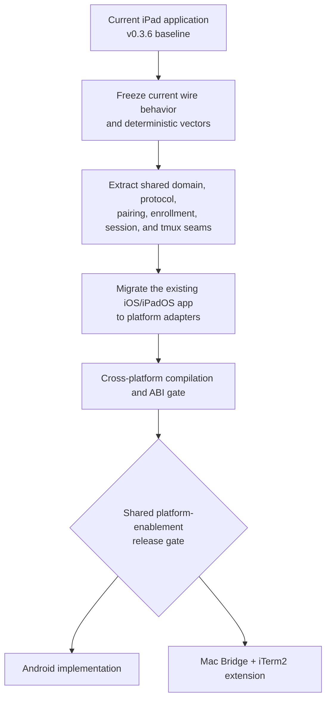
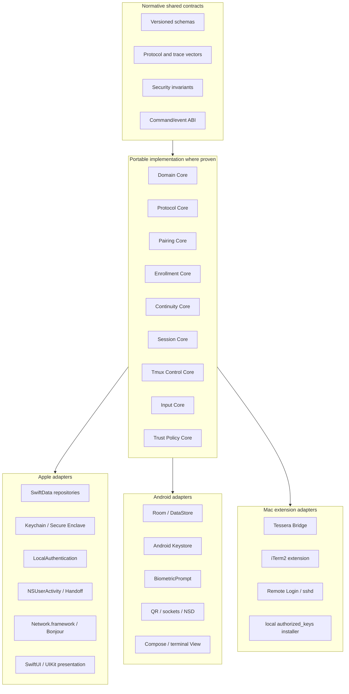

# Tessera Shared Platform Enablement

## Unified architecture, wire protocol, and core refactor before Android or Mac work

**Status:** Proposed technical specification
**Date:** August 23, 2026
**Repository baseline:** [`bambouville/tessera`](https://github.com/bambouville/tessera) public `main` at commit [`68183c2c5d5de99c1f8adc94b44e4f579e2de7f0`](https://github.com/bambouville/tessera/commit/68183c2c5d5de99c1f8adc94b44e4f579e2de7f0), Tessera v0.3.6 / build 7
**Supersedes:** the shared-refactor, protocol, continuity, enrollment, and tmux-extraction portions of the earlier Android and Mac-extension architecture documents
**Downstream documents:**

1. `tessera-android-architecture-after-shared-refactor.md`
2. `tessera-mac-iterm2-extension-after-shared-refactor.md`

---

## 1. Executive decision

Before adding either Android support or the Mac/iTerm2 continuity extension, Tessera should complete one **shared platform-enablement program** and migrate the existing Apple application onto it.

The predecessor is not merely a code move. It establishes one authoritative model for:

- secret-free host and route configuration;
- credentials as local signing/password capabilities rather than fields on a host DTO;
- continuation, bootstrap, enrollment, and pairing wire contracts;
- host resolution and trust-hint semantics;
- fresh owner authorization and stale-attempt invalidation;
- session commands, typed challenges, and events;
- tmux parsing, topology, grid authority, and immutable snapshots;
- persistence, security, networking, and UI adapter boundaries;
- compatibility vectors shared by Apple, Android, and Mac implementations.

After this predecessor passes its exit criteria, the work can branch cleanly:



The essential architectural rule is:

> **One protocol and policy model; native persistence, security stores, discovery, lifecycle, terminal rendering, and platform UX. Share implementations only where portability is proven, but always share wire specifications and conformance vectors.**

This preserves the current product model described by the repository—direct device-to-server SSH/Mosh connections, no Tessera backend, no Tessera account, and no data collection—while preventing Android and Mac from inventing parallel continuity and enrollment systems.

---

## 2. Important wire-protocol conclusion

### 2.1 No continuation-descriptor schema bump is required

The current `SessionActivityDescriptor` schema already contains what both downstream products need:

- stable destination host ID;
- exact SSH endpoint and ordered jump route;
- transport;
- launch mode;
- exact resolved tmux session name;
- optional public host-key comparison fingerprints;
- deterministic connection key.

It deliberately excludes credentials, commands, environment, notes, terminal contents, and local private-key references. A Mac-origin descriptor can therefore advertise the Mac SSH endpoint and a pinned tmux session, while Android can receive the same descriptor over a QR-established channel.

The shared work should:

1. move this schema into a portable protocol target;
2. replace dependencies on runtime `HostTransport` and `HostLaunchMode` with wire-specific enums;
3. preserve schema-v1 field names, values, validation behavior, sorted-key JSON, and the 3 KiB limit;
4. retain an explicit compatibility fixture proving that pre-refactor and post-refactor encoders produce identical bytes.

This is a **source-architecture change, not a wire change**.

### 2.2 Do not mutate shipped nearby-bootstrap v2

The repository currently defines nearby bootstrap as one coupled protocol epoch:

- versioned commitment and hello;
- recipient commitment ordering;
- X25519 transcript;
- six-digit SAS;
- directional HKDF material;
- encrypted frame version;
- public-key transfer;
- origin authorization proof;
- `BootstrapManifest`;
- durable import acceptance;
- per-host grant receipt;
- final completion acknowledgement.

`NearbyBootstrapProtocol.version` is currently `2`, and the repository explicitly freezes one schema folder per shipped version. Its transcript labels and state machine are bootstrap-specific.

Trying to make that v2 session also carry arbitrary continuation transactions would create a risky semantic fork inside a shipped protocol. Instead:

> **Freeze nearby-bootstrap v2 as a legacy compatibility epoch and introduce a separately versioned, purpose-bound pairing layer for new cross-platform flows.**

New builds may continue to accept and emit v2 for old Apple peers. Android and future Apple builds use the new pairing layer for QR continuity and new cross-platform setup.

### 2.3 Separate protocol layers that are currently coupled

The target protocol stack is:

```text
Rendezvous
  PairingOffer v1
    QR / local discovery / future relay coordinates

Authenticated secure channel
  PairingHandshake v1
    X25519 + commitment + purpose binding + SAS/optical binding
  PairingFrame v1
    directional sequence + AEAD + strict frame limits

Transactions carried by that channel
  ContinuationTransfer v1
  BootstrapTransaction v1 carrying BootstrapManifest v2
  EnrollmentTransaction v1 carrying device-public-key metadata
  Future AttachReceipt v1 / RevocationTransaction v1
```

Legacy compatibility remains:

```text
LegacyNearbyBootstrapV2
  exact shipped commitment/hello/transcript/frame/manifest transaction
```

This decomposition avoids tying manifest version, secure-channel version, and business-transaction version to the same integer forever.

---

## 3. Goals

1. Create a stable branch point from which Android and Mac work can proceed in parallel without both modifying the same app-target files and wire types.
2. Preserve all current Apple behavior before introducing any new protocol epoch.
3. Give every platform the same continuation, bootstrap, enrollment, trust, and tmux semantics.
4. Keep passwords and private key material platform-local.
5. Make non-exportable signing a first-class capability rather than assuming private-key bytes are available.
6. Ensure app lock, credential-policy mutation, and host edits invalidate in-flight authorization attempts consistently.
7. Define a coarse, language-neutral core boundary suitable for Swift-to-Kotlin bridging or a native Android fallback.
8. Make protocol compatibility independently testable through fixed vectors rather than through UI integration tests alone.
9. Keep the current nearby-bootstrap v2 compatibility path available for released Apple builds.
10. Establish clear ownership so platform branches add adapters rather than new protocol state machines.

---

## 4. Non-goals

This predecessor does **not** include:

- an Android application shell, terminal view, Room database, Android Keystore implementation, Play Billing, or Android foreground service;
- a Mac menu-bar application, iTerm2 Python extension, local tmux registry, Remote Login setup, or `authorized_keys` file writer;
- a cross-platform UI framework;
- a Tessera cloud account or mandatory relay;
- private-key synchronization;
- live migration of arbitrary non-tmux process trees;
- a production decision that every Swift SSH dependency must run on Android;
- a rewrite of the existing Mosh C++ core;
- a wholesale rewrite of `SessionView` before stable facades exist;
- schema changes made merely to rename Swift enum cases or packages.

---

## 5. Why this must be one predecessor

The earlier Android and Mac documents independently identified many of the same seams. Implementing them twice would create conflicts and incompatible abstractions.

| Existing responsibility | Android document needed | Mac document needed | Correct owner after this refactor |
|---|---|---|---|
| Continuation descriptor and validation | Decode over QR/local channel | Encode through Handoff | `TesseraProtocolCore` |
| Host UUID/route resolution | Resolve received Android/Apple descriptor | Let iOS resolve Mac endpoint | `TesseraDomainCore` + `TesseraContinuityCore` |
| Enrollment public-key schema | Describe Android Keystore key | Accept iOS public key and install locally | `TesseraEnrollmentCore` |
| Peer binding | QR/SAS transcript | Apple continuation stream | shared binding model + platform transport adapter |
| Fresh owner authorization | `BiometricPrompt` | LocalAuthentication on Mac | capability contract; platform implementation |
| Grant authorization snapshot | Prevent host/key drift | Prevent Mac target/key drift | shared grant engine |
| Bootstrap manifest | Import/export with Room | Not required for Mac MVP, but future setup-compatible | `TesseraProtocolCore` |
| Known-host trust semantics | Android TOFU repository | Mac fingerprint hint generation | shared records/policy + adapters |
| tmux name and target validation | Android attach/control mode | Validate selected local iTerm2/tmux target | `TmuxControlCore` |
| tmux topology and grid authority | Render Android windows/panes and takeover | Observe/mint exact session metadata only | shared engine/snapshot model |
| Session lifecycle abstraction | Kotlin app consumes commands/events | Mac does not render a client session | shared session contract; platform-specific consumption |
| Apple Handoff codec/publication | Receive on Apple side | Publish on Mac side | shared codec + `TesseraAppleContinuity` adapter |
| Platform persistence and secrets | Room/Keystore | Keychain/local files | platform adapters only |

The common predecessor therefore contains both the strict intersection and the shared architecture changes necessary to stop the platform branches from modifying the existing iOS monolith independently.

---

## 6. Repository findings that drive the design

### 6.1 Healthy seams already exist

The repository is not starting from zero.

- `Packages/TmuxControl` already contains the main control-mode parser, command handling, repaint logic, pane/window state, and grid-authority mechanism. Its main controller imports Foundation and Observation rather than UIKit.
- `Packages/ScrollDispatcher` explicitly implements a pure-Swift state machine with no UIKit dependency.
- `BootstrapManifest.swift` already uses wire-specific transport and launch enums and enforces strict field allowlists and resource limits.
- `NearbyHandshake.swift` already implements fresh X25519 keys, recipient commitment ordering, role-labelled transcripts, SAS, directional HKDF derivation, AEAD frames, sequence checks, and transaction receipts.
- `EnrollmentMessageTransport` already separates byte transport from enrollment behavior and distinguishes Apple-account, SAS-bound, and unbound peers.
- `SyncDeviceAccessGrantEngine` already binds user authorization to immutable host-route and public-key snapshots and consumes capabilities before suspension.
- `ContinuationResolver` is already mostly pure: UUID fast path, typed-route match, and explicit prefill.
- `MoshClient.h` already exposes a compact C++ lifecycle—start, tick, input, resize, repaint, shutdown, sockets, and output callback.
- `PortForwarding` and `ScrollDispatcher` already live in separate packages.

These should be extracted or split, not replaced.

### 6.2 Current app-target types cross too many boundaries

The current `Host` DTO combines:

- public endpoint and launch configuration;
- plaintext password;
- password revision provenance;
- local private-key filename;
- stored key UUID;
- jump-chain credentials;
- forwarding rules;
- continuation trust hints;
- live Keychain and SwiftData resolution.

`TerminalSession` is conceptually transport-neutral but is `@MainActor`, exposes an `AsyncStream`, carries a concrete `Host`, and exists partly to work around SwiftUI/`ObservableObject` limitations.

`KnownHostsStore` combines TOFU policy and import-conflict behavior with:

- NIOSSH key conversion;
- JSON file paths;
- actor persistence;
- display rows and localized behavior.

`SSHAuth` combines valuable policy-generation and in-flight cancellation rules with:

- Apple Security;
- Citadel/NIOSSH;
- Keychain;
- LocalAuthentication;
- SwiftData-driven policy refresh;
- localized errors.

`BootstrapCoordinator` and `EnrollmentCoordinator` combine strong transaction ordering with SwiftData, UIKit, Apple biometrics, Apple streams, and UI observation.

The shared refactor must preserve the policy while moving platform composition out.

### 6.3 Protocol coupling is inconsistent

`BootstrapManifest` already protects the wire from runtime enum growth, but `SessionActivityDescriptor` still encodes runtime `HostTransport` and `HostLaunchMode`. Enrollment wire types also expose Apple implementation names such as `secureEnclaveP256` and `secureEnclave`.

The target makes all wire types closed, explicit, and platform-neutral.

---

## 7. Target architecture



### 7.1 Two levels of sharing

The architecture distinguishes:

1. **Normative sharing**, which is mandatory:
   - schemas;
   - encoding rules;
   - state-transition rules;
   - security invariants;
   - fixed vectors;
   - command/event contracts.

2. **Implementation sharing**, which is conditional:
   - Swift packages may be used directly on Apple and Android when they compile and perform reliably;
   - Android may replace a shared Swift backend behind the same contract if a dependency or signer path fails the portability gate;
   - the Mac extension directly consumes Swift packages because it is an Apple target.

Android is therefore not allowed to diverge semantically merely because a native Kotlin backend is used.

---

## 8. Proposed packages and ownership

A practical end-state layout is:

```text
Packages/
  TesseraDomainCore/
  TesseraProtocolCore/
  TesseraPairingCore/
  TesseraEnrollmentCore/
  TesseraContinuityCore/
  TesseraInputCore/
  TesseraAppleContinuity/  # Foundation-only Apple adapter, not portable umbrella
  TesseraSessionCore/
  TesseraTrustCore/
  TesseraCoreABI/
  TmuxControl/
    Sources/TmuxControlCore/
    Sources/TmuxControlObservation/
  ScrollDispatcher/
  PortForwarding/
    Sources/PortForwardingModel/
    Sources/PortForwardingApple/
  MoshBridge/
    Sources/MoshCore/
    Sources/MoshCABI/
    Sources/MoshApple/

Platforms/
  Apple/
    Continuity/
    Persistence/
    Security/
    Networking/
    SessionPresentation/

ProtocolVectors/
  continuation/v1/
  legacy-nearby-bootstrap/v2/
  pairing/v1/
  bootstrap-manifest/v2/
  enrollment/v1/
  device-public-key/v1/
  device-public-key/v2/
  tmux/
```

This is a dependency map, not a requirement to move every source file in one commit. During migration, typealiases and adapters should keep the current application compiling.

### 8.1 Forbidden imports in portable targets

Portable targets must not import:

- SwiftUI;
- UIKit or AppKit;
- SwiftData;
- StoreKit;
- Security;
- LocalAuthentication;
- Network.framework;
- UserNotifications;
- GameController;
- platform file pickers or scene APIs.

Additional rules:

- shared code returns structured error codes and arguments, not localized sentences;
- shared code receives clocks, random sources, persistence, byte connections, and authorization through protocols;
- secret-bearing types are never `Codable`;
- no terminal callback crosses a bridge per byte, glyph, or cell;
- `@Observable`, `ObservableObject`, `AsyncStream`, Swift actors, and NIO channels do not form the Kotlin/JNI ABI;
- platform adapters never become dependencies of shared targets.

---

## 9. Shared domain model

### 9.1 Split public configuration from credentials

Replace the all-purpose `Host` DTO at core boundaries with:

```swift
public struct HostProfile: Codable, Equatable, Sendable {
    public let id: UUID
    public var name: String
    public var endpoint: HostEndpoint
    public var transport: HostTransportKind
    public var launch: HostLaunchPolicy
    public var jumpHostIDs: [UUID]
    public var portForwards: [PortForwardRule]
    public var tags: [String]
    public var osHint: String?
}

public struct HostEndpoint: Codable, Equatable, Sendable {
    public var user: String
    public var address: String
    public var port: UInt16
}

public enum LocalCredentialReference: Equatable, Sendable {
    case none
    case password(identityID: UUID)
    case key(keyID: UUID)
}
```

`LocalCredentialReference` is persistence metadata, not a wire type. The connection layer receives:

```swift
public struct ConnectionRequest: Sendable {
    public let destination: HostProfile
    public let route: [ResolvedRouteNode]
    public let credential: any CredentialCapability
    public let policyGeneration: UInt64
}
```

A `CredentialCapability` can provide a password once or sign an SSH challenge without exposing private material.

### 9.2 Secret-bearing invariants

- `HostProfile` cannot contain a password.
- A private-key filename or key-store handle cannot be encoded into continuation or bootstrap.
- `ResolvedCredential` and signer objects never conform to `Codable`.
- Platform repositories resolve local credential references only after app-lock and policy checks.
- Connection requests are short-lived and generation-bound.
- Jump-host credentials are capabilities per route node, not nested secret-bearing `Host` values.

### 9.3 Route identity

Retain the current typed route comparison principle:

- stable UUID is the fast path;
- ordered public endpoint coordinates are the independent-copy fallback;
- malformed or cyclic routes fail closed;
- connection-key strings remain persistence/wire metadata, not the sole structural comparator.

The shared resolver should absorb the pure parts of `ContinuationResolver`, `ContinuationTrustHintMapper`, route-reuse conflict checks, and insertion planning.

---

## 10. Continuity protocol and coordinator

### 10.1 `ContinuationDescriptorV1`

Move the existing descriptor into `TesseraProtocolCore` and rename only source symbols:

```swift
public enum ContinuityWireTransport: String, Codable, Sendable {
    case ssh
    case mosh
}

public enum ContinuityWireLaunchMode: String, Codable, Sendable {
    case autoTmux
    case pinnedTmux
    case customCommand
}
```

The encoded raw values remain identical to the current runtime enums. Preserve:

- `v`;
- `hostID`;
- `connectionKey`;
- `name`;
- `user`;
- `address`;
- `port`;
- `transport`;
- `launchMode`;
- `tmux`;
- `via`;
- `hostKeyFP`;
- sorted-key JSON;
- 3 KiB maximum;
- eight-hop maximum;
- exact connection-key validation;
- tmux-versus-reconnect invariant.

Move tmux-name validation from the Mosh bootstrap namespace into `TmuxControlCore`, then make both Mosh and continuity call the same validator.

### 10.2 Separate receipt from platform transport

Define a platform-neutral receive state machine:

```text
idle
received
stashedBehindLock
ready
resolving
needsHostAdmission
needsCredential
connecting
completed
cancelled
failed
```

Inputs include:

```text
receiveDescriptor(bytes, transportBinding)
unlock
consume
hostAdmissionCompleted
credentialEnrollmentCompleted
connectionCompleted
cancel
securityPolicyChanged
```

Apple Handoff, Android QR, and a future relay are adapters that deliver descriptor bytes plus a peer-binding claim.

### 10.3 Preserve honest continuation semantics

- `autoTmux` and `pinnedTmux` advertise **continue session**.
- `customCommand` advertises **reconnect**.
- Plain SSH or Mosh never claims to migrate an arbitrary live process.
- Terminal contents are never included in the descriptor.
- A host-key fingerprint remains a comparison hint unless a separate, owner-authorized bootstrap imports exact trust material.

---

## 11. Pairing protocol for new cross-platform flows

### 11.1 Keep legacy v2 intact

Move current code under a compatibility namespace or target without changing bytes:

```text
LegacyNearbyBootstrapV2
  LegacyNearbyHandshakeHelloV2 / LegacyNearbyHandshakeCommitmentV2
  LegacyNearbyHandshakeV2
  LegacyNearbyManifestTransferSessionV2
```

`TesseraProtocolCore` owns the epoch constants and version probe;
`TesseraBootstrapCore` is the single public owner of the released hello,
commitment, transcript, SAS, encrypted frames, and ordered transfer. Apple keeps
its current spellings as compatibility wrappers/typealiases only. The move must
precede any wire rename or schema change.

### 11.2 `PairingOfferV1`

The rendezvous object is short-lived and secret-free except for a one-time optical secret:

```text
version
offerID
purpose
expiresAt
originRole
originEphemeralKeyOrCommitment
endpointCandidates
oneTimeOpticalSecret
supportedPairingVersions
supportedTransactionVersions
optionalPayloadDigest
```

Purposes:

```text
continue
bootstrap
enroll
setUpAndContinue
```

It must not carry:

- passwords;
- private keys or handles;
- a bootstrap manifest;
- terminal contents;
- command history;
- known-host key material;
- a long-lived device token.

### 11.3 `PairingHandshakeV1`

Retain the proven cryptographic shape:

- fresh X25519 keys per attempt;
- explicit origin/recipient roles;
- recipient commitment before origin key disclosure;
- canonical length-delimited transcript;
- HKDF-SHA256;
- directional keys and nonces;
- ChaCha20-Poly1305;
- per-direction sequence numbers;
- replay, reflection, direction, and ordering checks;
- bounded frames;
- six-digit SAS.

Add what the current compatibility comments say a future multi-version protocol requires:

- bind raw negotiation inputs into the transcript;
- bind `purpose`;
- bind `offerID`;
- bind QR/optical secret proof where present;
- authenticate the selected transaction version;
- consume each offer and handshake attempt once.

The first product UX may keep SAS confirmation after a QR scan. Removing manual SAS requires a separate security review proving the optical secret is sufficiently strong, short-lived, single-use, and transcript-bound.

### 11.4 Generic encrypted envelopes

The secure channel should know only strict envelope kinds and size limits:

```text
peerDecision
transactionMessage
abort
completion
```

Transaction-specific decoding occurs only after the purpose and negotiated transaction version are authenticated.

Do not add an untyped dictionary or “extra” field. Every new message kind requires a protocol revision and vectors.

### 11.5 Discovery epoch and compatibility

Keep the shipped Bonjour epoch:

```text
_tessera-bootstrap._tcp  → legacy nearby-bootstrap v2 only
```

If the generic pairing layer later uses Bonjour/NSD discovery, give it a distinct epoch such as:

```text
_tessera-pair._tcp       → PairingProtocol v1+
```

QR offers may carry pairing endpoints directly and therefore do not depend on either service type.

Compatibility matrix after the shared release:

| Origin | Recipient | Path |
|---|---|---|
| Released v0.3.6 Apple | refactored Apple | legacy nearby-bootstrap v2 or Handoff descriptor v1 |
| Refactored Apple | released v0.3.6 Apple | explicitly supported legacy v2/Handoff v1 path |
| Refactored Apple | Android | Pairing v1 + selected transaction |
| Android | refactored Apple | Pairing v1 + selected transaction |
| Mac Bridge | released/refactored mobile build that understands Handoff v1 | bidirectional Handoff descriptor v1; enrollment compatibility negotiated separately |
| New Apple | new Apple | Pairing v1 preferred where product UX uses it; legacy v2 retained only for compatibility |

A decoder never guesses that a pairing-v1 frame is nearby-bootstrap v2 or vice versa.

---

## 12. Bootstrap transaction

### 12.1 Decouple manifest version from transport version

The current code sets:

```text
BootstrapManifest.currentVersion = NearbyBootstrapProtocol.version
```

That coupling should end without changing current manifest bytes.

Introduce:

```text
BootstrapManifestProtocol.currentVersion = 2
```

The current schema becomes `BootstrapManifestV2`. It can be carried by:

- legacy nearby-bootstrap v2;
- pairing/bootstrap transaction v1;
- a future file import;
- a future optional relay.

### 12.2 Preserve the current transaction ordering

The new `BootstrapTransactionV1` must retain the current safety sequence:

1. authenticated peer channel;
2. recipient public key;
3. fresh origin owner authorization;
4. authorization proof;
5. manifest;
6. recipient durably applies accepted records;
7. recipient sends manifest-hash/accepted-host acknowledgement;
8. origin installs selected public keys;
9. origin verifies remote mutation and returns one result per manifest host;
10. recipient durably records access state;
11. recipient acknowledges the grant receipt;
12. origin completes.

The current receipt semantics are an asset and must not be simplified to “message sent successfully.”

### 12.3 Split manifest data from platform mapping

Keep the strict manifest allowlist. Add platform import/export adapters:

```text
BootstrapManifestExporter
BootstrapManifestImporter
BootstrapAdmissionPlanner
BootstrapSettingsMapper
```

Import results should report:

```text
inserted
unchanged
conflict
mappedSetting
ignoredPlatformHint
requiresLocalCredential
```

Portable semantic settings and platform hints should be distinguishable. Changing the manifest fields for this distinction requires a new manifest version; it should not be smuggled into v2.

---

## 13. Enrollment and device public-key metadata

### 13.1 Preserve `EnrollmentMessageV1`

The request/install/record/complete ordering is already correct. Move it unchanged into `TesseraEnrollmentCore`.

### 13.2 Generalize peer binding

Replace Apple/SAS-specific branching with:

```swift
public struct PeerBinding: Equatable, Sendable {
    public enum Kind: Equatable, Sendable {
        case appleAccountContinuationStream
        case pairedTranscript(hash: Data, purpose: PairingPurpose)
        case unbound
    }

    public let kind: Kind
}
```

Only authenticated Apple continuation streams or a verified pairing transcript allow enrollment. Device names remain display-only.

### 13.3 Platform-neutral key metadata

The current wire names leak Apple implementation:

```text
secureEnclaveP256
secureEnclave
software
```

Source-only renaming of the algorithm case can preserve its raw SSH value:

```text
ecdsaNistP256 = "ecdsa-sha2-nistp256"
```

Protection metadata needs a versioned schema:

```text
DevicePublicKeyDescriptorV2
  id
  displayName
  algorithm
  sshBlob
  fingerprint
  protectionClaim

ProtectionClaim
  softwareExportable
  platformProtected
  platformHardwareBacked
  platformStrongHardware
  unknown
```

Rules:

- protection is display/audit metadata, not authorization;
- the SSH blob and fingerprint are validated independently;
- an Android key is never called “Secure Enclave”;
- a Mac or iOS key is not assumed to be hardware-backed solely because a peer says so;
- local key capability is authoritative only on the device that owns the private key.

Compatibility:

- keep decoding and emitting `EnrollmentPublicKeyV1` for old Apple peers;
- new pairing transactions may negotiate `DevicePublicKeyDescriptorV2`;
- adapters map v1 `secureEnclave` to v2 `platformHardwareBacked` for display only.

### 13.4 Fresh owner authorization

Rename biometric-specific core concepts to owner authorization:

```swift
public protocol FreshOwnerAuthorizing {
    func authorize(_ request: OwnerAuthorizationRequest) async throws
        -> FreshOwnerAuthorization
}
```

`FreshOwnerAuthorization` is:

- one-shot;
- attempt-scoped;
- host/route scoped;
- public-key scoped;
- time-bounded;
- invalidated by app lock, policy mutation, route mutation, cancellation, or attempt completion.

Apple, Android, and Mac supply different system UI; the grant engine receives only the capability.

---

## 14. Authentication policy and signer capabilities

The current `SSHAuthenticationPolicyStore` contains valuable cross-platform behavior:

- stable policy signatures;
- monotonically increasing generations;
- invalidation when a host, route, credential, or global policy changes;
- cancellation of pending handshakes on app lock/background security revocation;
- revalidation after asynchronous authorization.

Extract these semantics into `TesseraSessionCore`.

### 14.1 Credential capability

```text
CredentialCapability
  kind
  credentialID
  policyGeneration
  requiresOwnerAuthorization
  providePassword(attemptID)
  sign(payload, algorithm, attemptID)
```

Private key bytes are not part of the interface. Android Keystore, Apple Secure Enclave, and software-key implementations all conform through signing.

### 14.2 Challenge model

A session never synchronously invokes UI. It emits:

```text
HostKeyChallenge
CredentialChallenge
OwnerAuthorizationChallenge
ImportConflictChallenge
```

Each challenge carries:

- session ID;
- connection-attempt ID;
- policy generation;
- bounded public display metadata;
- an expiration/consumption rule.

The platform submits a typed response. Stale responses are rejected.

---

## 15. Shared session command/event facade

Evolve `TerminalSession` from a SwiftUI-shaped object into a command/event engine.

### 15.1 Commands

```text
connect
cancelConnect
disconnect
sendInput(bytes)
resize(cols, rows)
selectTmuxWindow(id)
selectTmuxPane(id)
createTmuxWindow
closeTmuxWindow
setFocused(bool)
setApplicationVisibility(state)
requestFullRepaint
submitChallengeResponse
```

### 15.2 Events

```text
stateChanged
terminalBytes
tmuxSnapshotChanged
gridAuthorityChanged
hostKeyChallenge
credentialChallenge
ownerAuthorizationChallenge
remoteWorkingDirectoryChanged
forwardingStateChanged
recoverableWarning
failure
diagnostics
```

### 15.3 Boundary requirements

- events include a session generation;
- terminal bytes are batched;
- no per-cell bridge calls;
- destruction is explicit;
- the facade owns no localized UI text;
- callbacks arrive on a documented executor/queue;
- Apple wraps the facade in Observation/SwiftUI adapters;
- Kotlin consumes the same coarse facade or an equivalent native implementation.

The Mac Bridge does not need to instantiate a terminal session, but it uses the same continuation and enrollment contracts.

---

## 16. Tmux refactor

`TmuxController.swift` has grown into a very large `@MainActor @Observable` object. It should be split by responsibility, not rewritten.

### 16.1 `TmuxControlCore`

Owns:

- DCS/control-mode detection;
- parser and command-response correlation;
- `%output` routing;
- pane/window topology;
- layouts and geometry;
- capture/repaint assembly;
- active pane/window state;
- grid-authority stamp parsing plus the stateful attach/query, claim,
  contest, peer-departure proof, fence, repaint, commit, settlement, timeout,
  and transport-reset lifecycle;
- command encoding;
- safe tmux target/name validation;
- immutable snapshots;
- deterministic trace playback.

### 16.2 Platform observation adapters

`TmuxControlObservation` on Apple converts snapshots/events into `@Observable`
state. Android consumes snapshots and drives the same stateful authority reducer
through the core ABI. Platform controllers own only transport I/O, geometry and
capture effects, renderer callbacks, and native presentation.

### 16.3 Mac helper subset

The Mac Bridge uses pure helpers for:

- session-name validation;
- tmux ID parsing;
- fixed query construction;
- session ID/name/socket validation;
- geometry capability checks.

iTerm2 API types do not enter `TmuxControlCore`.

### 16.4 Preserve current authority semantics

The existing `@tessera_authority` stamp remains the cross-device source of truth for geometry/continuation takeover. Authority is server-mediated through tmux; it is not inferred from the pairing channel.

The authority reducer is scoped to a logical session, not an individual SSH or
Mosh control channel. Reconnects therefore query the server stamp and retain a
known peer fail-closed; neither platform may interpret a failed query as an
empty stamp. Automatic reclaim requires an exact `list-clients` proof that
every attached identity is one of this device's positively identified control
or visible clients.

---

## 17. Input semantics

Keep `ScrollDispatcher` shared. It already distinguishes:

- primary-screen local scrollback;
- alternate-screen mouse forwarding;
- alternate-screen arrow translation;
- bounded velocity/inertia.

Implement only neutral input semantics in `TesseraInputCore`:

- modifier normalization;
- terminal key-sequence mapping where platform-independent;
- mouse button/wheel encoding;
- reset rules on terminal-mode changes.

Remain native:

- UIKit gesture recognizers;
- Android `MotionEvent`/`KeyEvent`;
- IME composition;
- focus/responder behavior;
- accessibility;
- view-level gesture arbitration.

---

## 18. Known-host trust split

Create a portable trust-policy layer with:

```text
TrustedHostRecord
PendingHostKeyChange
KnownHostCheckResult
KnownHostImportResult
KnownHostConflictPolicy
OpenSSHKnownHostsCodec
```

Platform repositories own storage. SSH adapters own conversion between backend key objects and canonical SSH wire blobs.

Preserve the current two-level rule:

- a continuation fingerprint is a comparison hint for explicit local TOFU;
- exact trust material may be imported as a pin only through a separately encrypted, authenticated, owner-authorized bootstrap selection;
- a conflicting local pin wins and becomes an explicit review state rather than being overwritten silently.

---

## 19. Adapter contracts

| Contract | Apple iOS/iPadOS | Android | Mac extension |
|---|---|---|---|
| `HostRepository` | SwiftData | Room | stable Mac endpoint registry only |
| `CredentialRepository` | Keychain/Secure Enclave | Android Keystore/encrypted local storage | Keychain for bridge identity |
| `CredentialSigner` | Security/Crypto adapters | JCA/Android Keystore | normally not needed for outgoing SSH |
| `KnownHostsRepository` | current JSON migration or new Apple repository | Room/file repository | local sshd fingerprint provider |
| `FreshOwnerAuthorizer` | LocalAuthentication | BiometricPrompt/device credential | LocalAuthentication |
| `PairingByteConnection` | Network.framework/continuation stream | sockets/NSD | Handoff stream plus Pairing v1 local channel |
| `ContinuationTransport` | NSUserActivity receive/publish | QR/local channel | NSUserActivity receive/publish plus QR/local channel |
| `BootstrapManifestImporter` | SwiftData | Room | not required for MVP |
| `AuthorizedKeyInstaller` | remote SSH installer | remote SSH installer | local atomic `authorized_keys` installer |
| `TerminalRenderer` | SwiftTerm/UIKit | Android terminal View | iTerm2 owns rendering |
| `SessionLifecycleHost` | scene lifecycle | Android service/process lifecycle | Bridge app lifecycle |
| `PortListener` | Network.framework | Android sockets | not required |
| `PurchaseEntitlement` | StoreKit | Play Billing | not required |

---

## 20. Apple migration plan

The existing iOS/iPadOS application must consume the new seams before the branch point.

### 20.1 Sequence

#### Step A — freeze behavior

- capture continuation-v1 golden payloads;
- freeze nearby-bootstrap-v2 commitment, hello, transcript, SAS, keys/nonces, frames, manifest, and receipts;
- freeze enrollment-v1 message vectors;
- capture tmux traces and expected snapshots;
- add tests proving excluded secret fields cannot be represented.

#### Step B — move wire types unchanged

- extract continuation schema;
- extract bootstrap manifest;
- extract enrollment messages;
- extract legacy nearby-bootstrap v2;
- use typealiases to keep app call sites compiling;
- prohibit any rename and schema change in the same commit.

#### Step C — decouple runtime and wire models

- introduce wire-only transport and launch enums;
- move localized error rendering to Apple adapters;
- decouple manifest version from nearby transport version;
- move SSH-key parsing behind canonical-blob adapters;
- verify byte-for-byte compatibility.

#### Step D — split domain and persistence

- introduce `HostProfile`, routes, and local credential references;
- make Apple repositories map SwiftData rows to domain snapshots;
- resolve credentials after security gating;
- split known-host policy from JSON persistence/NIOSSH conversion.

#### Step E — split coordinators

- make continuity receive/resolution state transport-neutral;
- extract enrollment service and grant engine;
- extract bootstrap transaction state;
- retain Apple `@Observable` wrappers, SwiftData import/export, and LocalAuthentication adapters.

#### Step F — split session/tmux presentation

- create command/event session facade;
- wrap it for existing SwiftUI;
- split `TmuxControlCore` from Observation;
- keep existing `SessionView` behavior while moving policy ownership out.

#### Step G — add new pairing layer

- implement `PairingOfferV1`, `PairingHandshakeV1`, and generic frames;
- add purpose and negotiation binding;
- implement continuation/bootstrap/enrollment transactions;
- retain legacy nearby-bootstrap v2 for compatibility;
- perform targeted cryptographic review.

#### Step H — Android compilation/ABI gate

- compile portable packages with the official Swift SDK for Android;
- exercise a coarse command/event bridge;
- document which implementations are shared and which remain contract-only;
- freeze the branch contract.

### 20.2 Commit discipline

Never combine all three of these in one change:

1. move files;
2. rename concepts;
3. alter wire bytes.

Use the order:

```text
move unchanged → prove parity → rename/generalize → add versioned behavior
```

This makes failures attributable and keeps downgrade support possible.

---

## 21. Proposed repository DAG

```mermaid
flowchart LR
    P0[P0 vectors and forbidden-import checks]
    P1[P1 protocol packages, byte-identical]
    P2[P2 domain/credential/trust split]
    P3[P3 continuity/enrollment/bootstrap coordinators]
    P4[P4 session facade and tmux core split]
    P5[P5 existing Apple app fully on adapters]
    P6[P6 Pairing v1 + compatibility matrix]
    P7[P7 Android compile/ABI and Mosh C-ABI gates]
    R[Shared release gate]

    P0 --> P1 --> P2 --> P3 --> P4 --> P5 --> P6 --> P7 --> R
```



Some implementation work may overlap internally, but merge order should preserve this dependency direction.

---

## 22. Testing and CI

### 22.1 Fixed vectors

Check in vectors for:

- continuation descriptor v1 canonical encoding and rejection cases;
- legacy nearby-bootstrap v2 commitment and hello;
- v2 transcript and commitment digest;
- v2 SAS, keys, nonces, and encrypted frames;
- bootstrap manifest v2, unknown-field rejection, and limits;
- enrollment messages v1;
- public-key descriptor v1 and v2;
- pairing offer/handshake/frame v1;
- continuation transaction v1;
- bootstrap transaction receipts;
- tmux parser traces, topology, repaint, and authority changes.

### 22.2 CI lanes

```text
Apple package tests
iOS/iPadOS app unit and UI tests
macOS package tests
Swift Android package compilation/tests
Kotlin conformance-vector tests
Mosh C/C++ ABI tests
forbidden-import static checks
wire-byte compatibility checks
dependency/license/SBOM checks
```

### 22.3 Cross-language conformance

Even when Android uses the Swift implementation, Kotlin tests should independently parse vectors and verify:

- field names;
- limits;
- version errors;
- canonical hashes;
- state-transition rejection;
- challenge-generation behavior.

This prevents the bridge itself from becoming the only specification.

---

## 23. Security invariants

These are branch-release blockers:

1. Continuation and QR payloads contain no passwords, private keys, private-key handles, saved credential IDs, terminal contents, command history, environment, or clipboard data.
2. Secret-bearing capabilities are non-`Codable` and short-lived.
3. Hardware-backed keys sign through platform APIs; they are not exported.
4. Legacy nearby-bootstrap v2 bytes remain frozen.
5. New pairing binds purpose, version negotiation, offer ID, roles, ephemeral keys, and optical proof into the authenticated transcript.
6. Pairing attempts and QR offers are one-time and short-lived.
7. Display names, Bonjour/NSD names, and platform-protection claims never authorize.
8. Host-key hints never silently create pins.
9. Exact trusted-host material transfers only through explicit, owner-authorized bootstrap selection.
10. Remote or local `authorized_keys` mutation requires a one-shot authorization bound to the exact public key and target route.
11. Import acceptance precedes remote grants.
12. Completion is not reported until remote/local mutation, durable records, and acknowledgements finish.
13. App lock, background security revocation, host edits, credential changes, and route changes invalidate in-flight attempts.
14. Port forwarding remains loopback-only by default.
15. Diagnostics never contain terminal content, passwords, private material, QR secrets, or raw unredacted payloads.

---

## 24. Branch contract and exit criteria

Android and Mac branches may begin from the common baseline only when:

### 24.1 Protocol

- continuation-v1 vectors are byte-identical to v0.3.6;
- legacy nearby-bootstrap-v2 vectors are unchanged;
- bootstrap-manifest versioning is decoupled from transport versioning;
- enrollment-v1 compatibility is preserved;
- new pairing-v1 schemas and downgrade behavior are documented and tested;
- every decoder has explicit limits and version handling.

### 24.2 Architecture

- public host configuration no longer contains plaintext credentials at shared boundaries;
- credential use is capability-based;
- trust policy is separated from platform persistence and SSH backend types;
- continuity, bootstrap, and enrollment state machines do not import SwiftUI/UIKit/SwiftData/Network/Security;
- session UI consumes commands/events rather than owning policy;
- tmux deterministic state and snapshots are separate from Observation.

### 24.3 Existing Apple product

- current iPad behavior and security tests pass;
- Apple Handoff still receives and publishes schema v1;
- Apple-to-Apple nearby setup still works with v2;
- app lock and policy invalidation behavior remains intact;
- no user-visible migration regression is introduced merely for Android or Mac.

### 24.4 Portability

- portable packages compile in the selected Swift Android toolchain;
- the coarse ABI can stream realistic terminal byte batches without unacceptable overhead;
- shared implementation versus contract-only decisions are recorded per package;
- the Mac target can import shared continuity/enrollment/tmux helpers without app-target dependencies.

### 24.5 Documentation

- package ownership and forbidden imports are recorded;
- protocol schemas/vectors are checked in;
- downstream Android and Mac docs reference only stable public contracts;
- any unresolved portability decision is isolated behind an adapter rather than left as a platform-branch source conflict.

---

## 25. Effort estimate

Planning range for the complete common predecessor:

| Workstream | Estimated effort |
|---|---:|
| Wire/vector freeze and compatibility harness | 1–2 engineer-weeks |
| Protocol/domain extraction | 3–5 engineer-weeks |
| Credential, trust, and authorization split | 2–4 engineer-weeks |
| Coordinator extraction and Apple adapters | 3–5 engineer-weeks |
| Session facade and tmux core/Observation split | 3–6 engineer-weeks |
| Pairing v1 and security review | 3–5 engineer-weeks |
| Android compilation/ABI portability gate | 2–4 engineer-weeks |
| **Total** | **17–31 engineer-weeks** |

This range is larger than a simple package extraction because it includes migrating the current Apple app, preserving shipped wire epochs, creating the generic pairing layer, and proving the branch boundary.

Two senior engineers can overlap protocol/domain work with session/tmux extraction after vectors are frozen. The final Apple migration and pairing security review remain integration bottlenecks.

---

## 26. Primary risks

| Risk | Consequence | Mitigation |
|---|---|---|
| Refactor accidentally changes shipped bytes | Old devices cannot continue/bootstrap | golden vectors before moves; byte-identity CI |
| Generic pairing over-abstracts the current strong flow | security ordering becomes weaker | retain strict transaction state machines; generic only at secure-channel layer |
| Host split duplicates policy in adapters | inconsistent credential invalidation | one shared policy-generation model and conformance suite |
| Tmux refactor becomes a rewrite | regressions in a large mature state machine | extract parser/state unchanged; immutable snapshot adapter; trace replay |
| Swift Android dependency graph fails | Android branch blocked | normative contract and replaceable ABI; per-component fallback |
| Apple UI migration expands scope | delayed branch point | facade-first migration; no visual rewrite requirement |
| v1/v2/vNext naming becomes confusing | compatibility bugs | explicit protocol registry and schema directories |
| Mac and Android branches still edit shared packages | merge contention | branch contract; shared-core owner reviews versioned API changes |

---

## 27. Immediate implementation sequence

1. Add `ProtocolVectors/continuation/v1` from the current encoder.
2. Add complete legacy nearby-bootstrap-v2 vectors and copy the current schema freeze into a dedicated compatibility target.
3. Extract continuation, bootstrap manifest, and enrollment message types byte-identically.
4. Introduce wire-only continuation enums with old raw values.
5. Decouple `BootstrapManifest` version from `NearbyBootstrapProtocol`.
6. Split `Host` into public profile/route and local credential resolution, retaining compatibility adapters.
7. Split known-host policy from storage and NIOSSH conversion.
8. Extract owner-authorization and grant-capability semantics from biometric/UI composition.
9. Create session command/event facade and migrate the existing Apple session presentation.
10. Split `TmuxControlCore` from its Observation wrapper.
11. Implement purpose-bound pairing v1 and transaction adapters; retain legacy v2.
12. Add Android compilation and coarse ABI tests.
13. Cut the shared release gate and start Android and Mac branches in parallel.

---

## 28. Final recommendation

Adopt this shared platform-enablement work as a formal product milestone, not an incidental prelude inside either platform branch.

The revised architecture is:

```text
Current Tessera
  ↓
Freeze shipped contracts
  ↓
Shared domain + protocol + pairing + enrollment + session + tmux architecture
  ↓
Existing Apple app migrated to adapters
  ↓
Portability and ABI gate
  ↓
┌───────────────────────────────┬────────────────────────────────┐
│ Android native application    │ Mac Bridge + iTerm2 extension  │
└───────────────────────────────┴────────────────────────────────┘
```

The existing Handoff descriptor is already sufficient and should remain schema v1. The current nearby-bootstrap v2 should be preserved exactly. New cross-platform QR continuity should use a new, purpose-bound pairing layer rather than changing a shipped bootstrap-specific state machine in place.

Mac Bridge is a bidirectional recipient as well as an origin. Same-account
Apple devices use Handoff; Android and different-account Apple devices use the
same Pairing v1 channel. First pairing uses QR/SAS. A later product epoch may
record owner-approved peer public identities so routine nearby continuation can
use authenticated Bonjour/NSD discovery without rescanning QR; such a record is
not a bearer token and every transaction still uses fresh ephemeral keys.

That gives Tessera one durable architecture while allowing each platform to remain native where it matters.

---

## 29. Repository references

Pinned to the reviewed public commit:

- [README](https://github.com/bambouville/tessera/blob/68183c2c5d5de99c1f8adc94b44e4f579e2de7f0/README.md)
- [Host.swift](https://github.com/bambouville/tessera/blob/68183c2c5d5de99c1f8adc94b44e4f579e2de7f0/Tessera/Host.swift)
- [TerminalSession.swift](https://github.com/bambouville/tessera/blob/68183c2c5d5de99c1f8adc94b44e4f579e2de7f0/Tessera/TerminalSession.swift)
- [SessionActivityDescriptor.swift](https://github.com/bambouville/tessera/blob/68183c2c5d5de99c1f8adc94b44e4f579e2de7f0/Tessera/Continuity/SessionActivityDescriptor.swift)
- [ActivityBroadcaster.swift](https://github.com/bambouville/tessera/blob/68183c2c5d5de99c1f8adc94b44e4f579e2de7f0/Tessera/Continuity/ActivityBroadcaster.swift)
- [ContinuationCoordinator.swift](https://github.com/bambouville/tessera/blob/68183c2c5d5de99c1f8adc94b44e4f579e2de7f0/Tessera/Continuity/ContinuationCoordinator.swift)
- [ContinuationResolver.swift](https://github.com/bambouville/tessera/blob/68183c2c5d5de99c1f8adc94b44e4f579e2de7f0/Tessera/Continuity/ContinuationResolver.swift)
- [BootstrapManifest.swift](https://github.com/bambouville/tessera/blob/68183c2c5d5de99c1f8adc94b44e4f579e2de7f0/Tessera/Bootstrap/BootstrapManifest.swift)
- [NearbyBootstrapCompatibility.swift](https://github.com/bambouville/tessera/blob/68183c2c5d5de99c1f8adc94b44e4f579e2de7f0/Tessera/Bootstrap/NearbyBootstrapCompatibility.swift)
- [NearbyHandshake.swift](https://github.com/bambouville/tessera/blob/68183c2c5d5de99c1f8adc94b44e4f579e2de7f0/Tessera/Bootstrap/NearbyHandshake.swift)
- [NearbyTransferService.swift](https://github.com/bambouville/tessera/blob/68183c2c5d5de99c1f8adc94b44e4f579e2de7f0/Tessera/Bootstrap/NearbyTransferService.swift)
- [BootstrapCoordinator.swift](https://github.com/bambouville/tessera/blob/68183c2c5d5de99c1f8adc94b44e4f579e2de7f0/Tessera/Bootstrap/BootstrapCoordinator.swift)
- [EnrollmentMessages.swift](https://github.com/bambouville/tessera/blob/68183c2c5d5de99c1f8adc94b44e4f579e2de7f0/Tessera/Enrollment/EnrollmentMessages.swift)
- [EnrollmentService.swift](https://github.com/bambouville/tessera/blob/68183c2c5d5de99c1f8adc94b44e4f579e2de7f0/Tessera/Enrollment/EnrollmentService.swift)
- [EnrollmentCoordinator.swift](https://github.com/bambouville/tessera/blob/68183c2c5d5de99c1f8adc94b44e4f579e2de7f0/Tessera/Enrollment/EnrollmentCoordinator.swift)
- [KnownHostsStore.swift](https://github.com/bambouville/tessera/blob/68183c2c5d5de99c1f8adc94b44e4f579e2de7f0/Tessera/KnownHostsStore.swift)
- [SSHAuth.swift](https://github.com/bambouville/tessera/blob/68183c2c5d5de99c1f8adc94b44e4f579e2de7f0/Tessera/SSHAuth.swift)
- [TmuxControl](https://github.com/bambouville/tessera/tree/68183c2c5d5de99c1f8adc94b44e4f579e2de7f0/Packages/TmuxControl)
- [AutoTmuxScript.swift](https://github.com/bambouville/tessera/blob/68183c2c5d5de99c1f8adc94b44e4f579e2de7f0/Packages/TmuxControl/Sources/TmuxControl/AutoTmuxScript.swift)
- [ScrollDispatcher](https://github.com/bambouville/tessera/tree/68183c2c5d5de99c1f8adc94b44e4f579e2de7f0/Packages/ScrollDispatcher)
- [MoshBridge](https://github.com/bambouville/tessera/tree/68183c2c5d5de99c1f8adc94b44e4f579e2de7f0/Packages/MoshBridge)
- [Citadel Package.swift](https://github.com/bambouville/tessera/blob/68183c2c5d5de99c1f8adc94b44e4f579e2de7f0/Packages/Citadel/Package.swift)

### External implementation references

These inform portability and adapter feasibility; they do not override repository-derived protocol behavior:

- [Getting Started with the Swift SDK for Android](https://swift.org/documentation/articles/swift-sdk-for-android-getting-started.html)
- [Swift Android Workgroup](https://swift.org/android-workgroup/)
- [Android Keystore](https://developer.android.com/privacy-and-security/keystore)
- [Android BiometricPrompt](https://developer.android.com/identity/sign-in/biometric-auth)
- [Android foreground services](https://developer.android.com/develop/background-work/services/fgs)
- [Implementing Handoff in Your App](https://developer.apple.com/documentation/foundation/implementing-handoff-in-your-app)
- [NSUserActivity continuation streams](https://developer.apple.com/documentation/foundation/nsuseractivity/supportscontinuationstreams)
